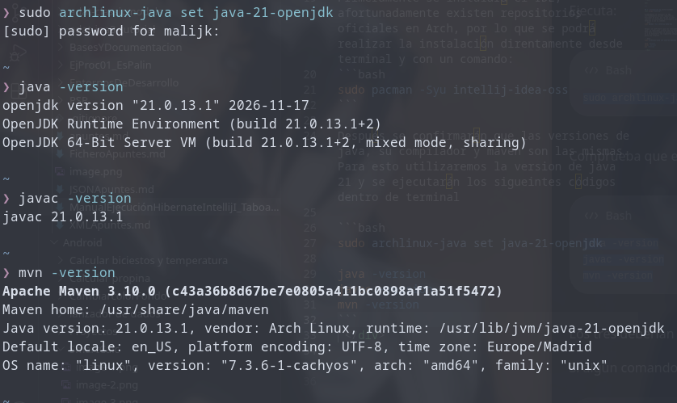
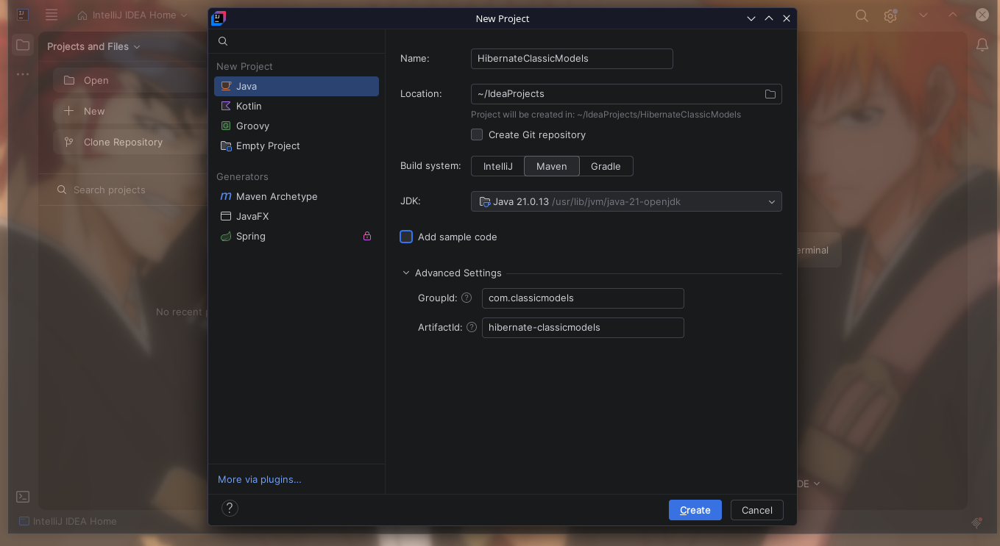
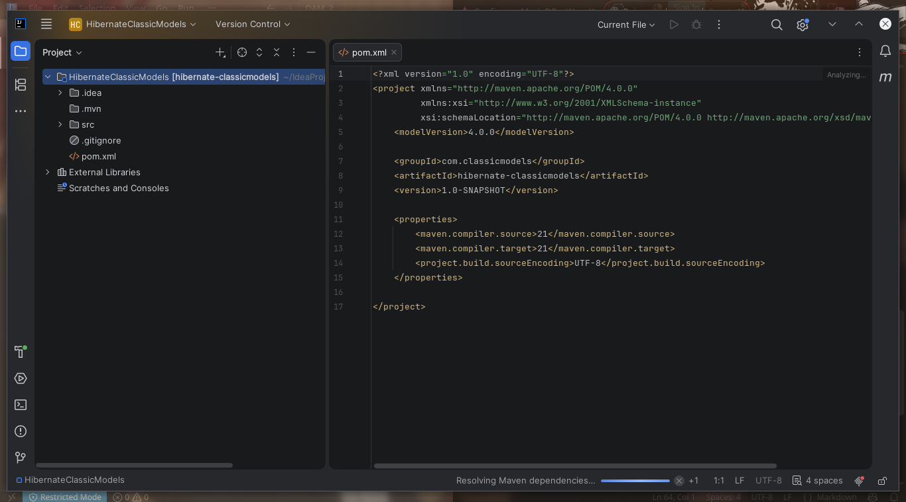
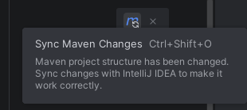
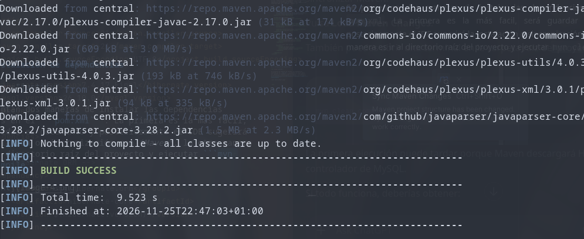
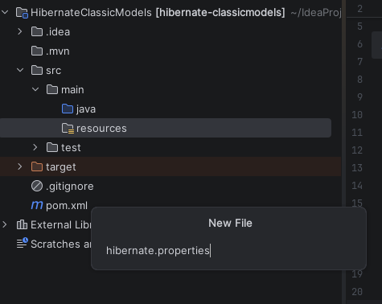
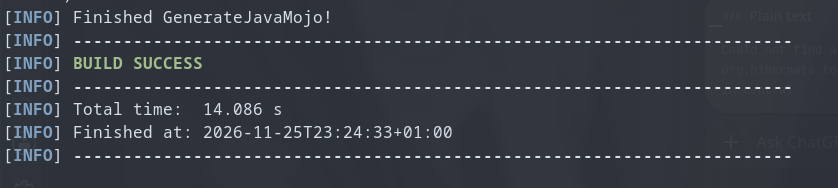
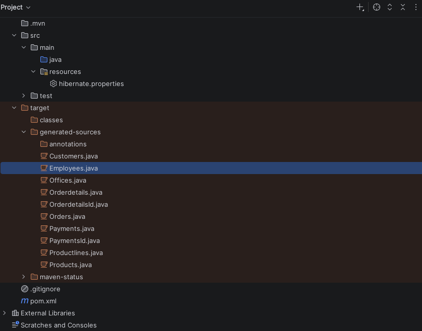
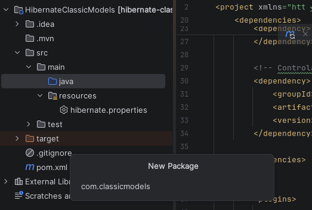
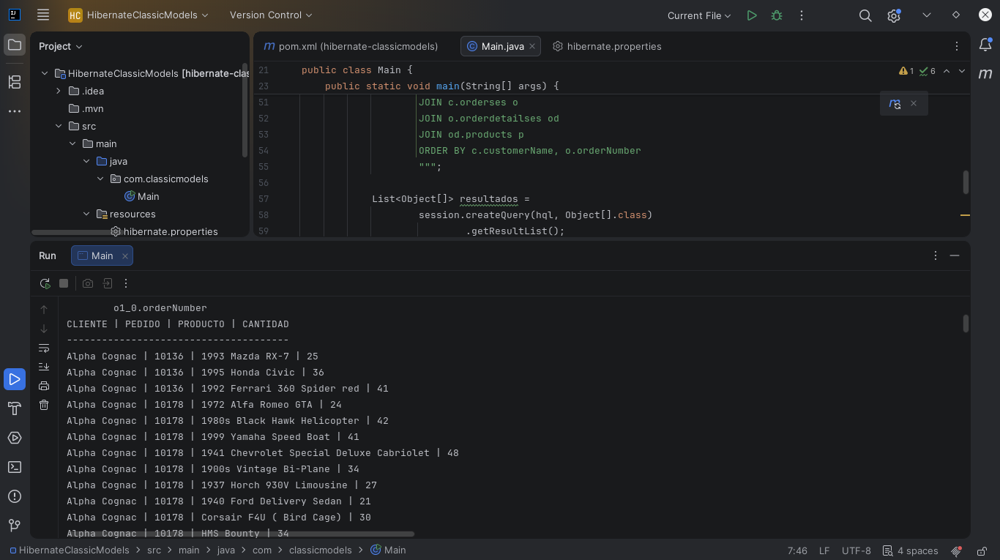

# <center>IES FRANCISCO DE GOYA</center>
__NOMBRE:__ Martin Taboada  
__CURSO:__ DAM 2
## <center> __Acceso a datos:__</center>   <center> __Manual de implementación de *Hibernate* en *IntellijIdea*__</center>

<div align="justify">

El presente documento expondrá una guia acerca de la implementación de *Hibernate* en el IDE de *IntellijIdea*, acorde con las indicaciones dadas en el aula virtual. Se ha escogido esta opción frente a las demás considerando la opinión de la IA(ChatGPT) acerca de cual de las opciones podría ser más recomendables en cuando a un futuro entorno profesional, todo esto con el fin de tener una mejor preparación en el mediano plazo. La instalación del IDE y la implemenetación de *Hibernate* se realizarádesde un ordenador con Cachyos, además, la base de datos utilizada será *classicmodels*.

 </div>

<br>

---

## 1. Instalación de *IntellijIdea*
<div align="justify">

Primeramente se instalará el IDE, afortunadamente existen repositorios oficiales en Arch, por lo que se podrá realizar la instalación direntamente desde terminal y con un comando:
```bash
sudo pacman -Syu intellij-idea-oss
```

Después se confirmarán que las versiones de java, su compilador y maven son las mismas. Para esto utilizaremos la version de java 21 y se ejecutarán los sigueintes códigos dentro de terminal 

```bash
sudo archlinux-java set java-21-openjdk

java -version
javac -version
mvn -version
```

(En el caso de no tener instalado maven se procederá previamente a ejecutar el codigo ```sudo pacman -S maven```)



 </div>

---

## 2. Creación del proyecto *Maven*

<div align="justify">

Dentro de *IntellijIdea* se procederá a la realización de los sigueintes pasos:

1. Seleccionar New Project.

2. En el panel izquierdo seleccionar Java.

3. En Build System seleccionar Maven.

4. Seleccionar JDK 21.

4. Configurar estos GroupId como *com.classicmodels* y ArtefactID como *hibernate-classicmodels* :


</div>







---

## 3. Configuracion de ```pom.xml```

<div align="justify">

A continuación de modificará el ```pom.xml```: dentro de la etiqueta de properties se añadirá la versión de mysql y de hibernate(se utilizará Hibernate ORM 7.4.17.Final, que es la versión estable más reciente disponible en la documentación oficial a fecha de hoy); finalmente se añadirán las dependencias del controlador de MySQL en java *JDBC* y la de *Hibernate ORM*. El ```pom.xml``` quedará así:

```xml

<?xml version="1.0" encoding="UTF-8"?>
<project xmlns="http://maven.apache.org/POM/4.0.0"
         xmlns:xsi="http://www.w3.org/2001/XMLSchema-instance"
         xsi:schemaLocation="http://maven.apache.org/POM/4.0.0 http://maven.apache.org/xsd/maven-4.0.0.xsd">
    <modelVersion>4.0.0</modelVersion>

    <groupId>com.classicmodels</groupId>
    <artifactId>hibernate-classicmodels</artifactId>
    <version>1.0-SNAPSHOT</version>

    <properties>
        <maven.compiler.source>21</maven.compiler.source>
        <maven.compiler.target>21</maven.compiler.target>
        <project.build.sourceEncoding>UTF-8</project.build.sourceEncoding>

        <hibernate.version>7.4.17.Final</hibernate.version>
        <mysql.version>26.10.0</mysql.version>
    </properties>

    <dependencies>

        <!-- Hibernate ORM -->
        <dependency>
            <groupId>org.hibernate.orm</groupId>
            <artifactId>hibernate-core</artifactId>
            <version>${hibernate.version}</version>
        </dependency>

        <!-- Controlador JDBC de MySQL -->
        <dependency>
            <groupId>com.mysql</groupId>
            <artifactId>mysql-connector-j</artifactId>
            <version>${mysql.version}</version>
        </dependency>

    </dependencies>
</project>

```


</div>


---

## 4. Instalación de dependencias

<div align="justify">

Se presentan dos maneras de instalar las dependencias presentes en el ```pom.xml```. La primera es la más facil, será guardar el documento y posteriormente el IDE sugerirá la instalación o sincronización con *Maven*, la otra manera es ir al directorio raíz del proyecto y ejecutar ```mvn clean compile```.





</div>

---

## 5. Conexión con MySQL y generación de clases con tablas

<div align="justify">

Dentro de ```src/main/resources``` se creará un documento ```hibernate.properties```: 


Y se pegará el sigiente texto, cabe aclarar que hay un apartado en el que se especifica el usuario y contraseña de mysql que se utilizará para realizar la conexion:

``` 
# Configuración de conexión MySQL
hibernate.connection.driver_class=com.mysql.cj.jdbc.Driver

hibernate.connection.url=jdbc:mysql://localhost:3306/classicmodels

hibernate.connection.username=[USUARIO]
hibernate.connection.password=[CONTRASEÑA]

# Base de datos de trabajo
hibernate.default_catalog=classicmodels

# No modificar la estructura de la base de datos
hibernate.hbm2ddl.auto=none

# Mostrar consultas SQL
hibernate.show_sql=true
hibernate.format_sql=true


```
Posteriormente se preparará la generación automática de tablas, dentro de terminal, en el directorio raiz del proyecto se ejecutará el comando ```mvn org.hibernate.tool:hibernate-tools-maven:7.3.13.Final:hbm2java```.
Según la version escogida podrían haber problemas, la terminal especificará si fue correcto, añadiendo el hecho de que se pueden apreciar las clases generadas en ```target/generated-sources/```.

</div>







añadir pasos sobre el cambio en el pom.xml




resultado final




