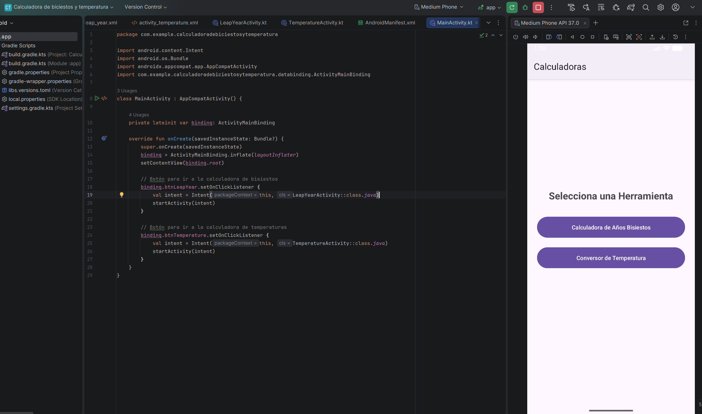
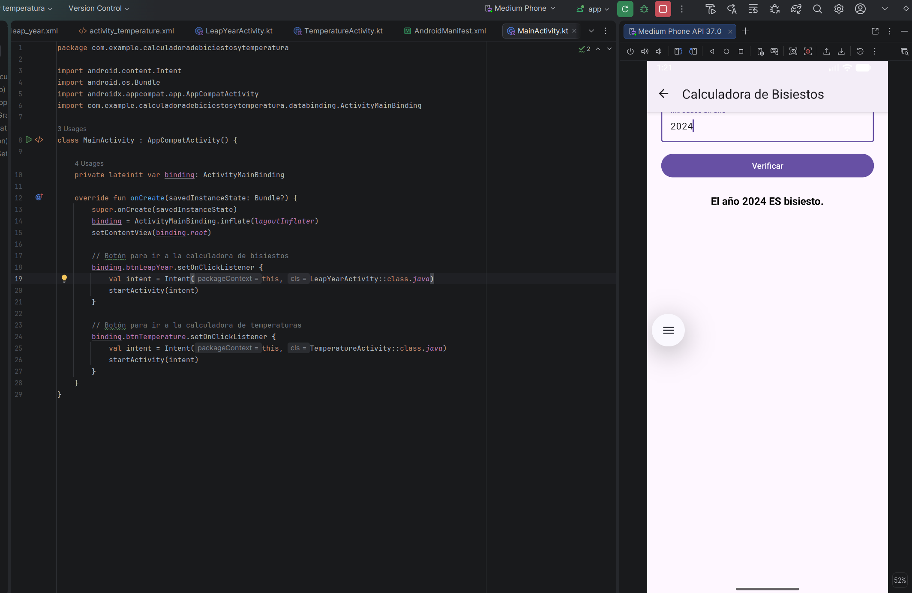
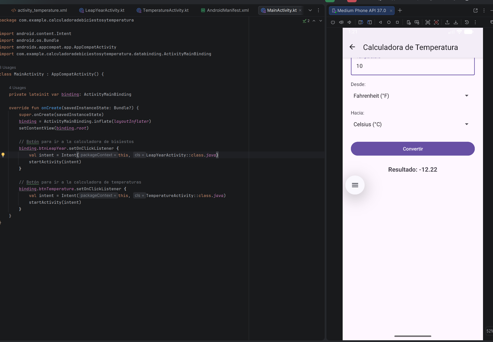

# <center>IES FRANCISCO DE GOYA</center>
__NOMBRE:__ Martin Taboada  
__CURSO:__ DAM 2
## <center> __Programación Multimedia y Dispositivos Móviles:__</center>   <center> __Calculadora de biciestos y temperatura__</center>
A continuación se presentarán evidencias sobre el ejercicio planteado en el aula virtual, se presentarán tanto las imágenes como el texto plano del fragmento del código: 
### __MainActivity.kt__
```
package com.example.calculadoradebiciestosytemperatura

import android.content.Intent
import android.os.Bundle
import androidx.appcompat.app.AppCompatActivity
import com.example.calculadoradebiciestosytemperatura.databinding.ActivityMainBinding

class MainActivity : AppCompatActivity() {

    private lateinit var binding: ActivityMainBinding

    override fun onCreate(savedInstanceState: Bundle?) {
        super.onCreate(savedInstanceState)
        binding = ActivityMainBinding.inflate(layoutInflater)
        setContentView(binding.root)

        // Botón para ir a la calculadora de bisiestos
        binding.btnLeapYear.setOnClickListener {
            val intent = Intent(this, LeapYearActivity::class.java)
            startActivity(intent)
        }

        // Botón para ir a la calculadora de temperaturas
        binding.btnTemperature.setOnClickListener {
            val intent = Intent(this, TemperatureActivity::class.java)
            startActivity(intent)
        }
    }
}
```

### __LeapYearActivity.kt__
```
package com.example.calculadoradebiciestosytemperatura

import android.os.Bundle
import android.widget.Toast
import androidx.appcompat.app.AppCompatActivity
import com.example.calculadoradebiciestosytemperatura.databinding.ActivityLeapYearBinding

class LeapYearActivity : AppCompatActivity() {

    private lateinit var binding: ActivityLeapYearBinding

    override fun onCreate(savedInstanceState: Bundle?) {
        super.onCreate(savedInstanceState)
        binding = ActivityLeapYearBinding.inflate(layoutInflater)
        setContentView(binding.root)

        supportActionBar?.setDisplayHomeAsUpEnabled(true)
        title = "Calculadora de Bisiestos"

        binding.btnCheckYear.setOnClickListener {
            val yearInput = binding.etYear.text.toString()

            if (yearInput.isNotEmpty()) {
                val year = yearInput.toInt()
                if (isLeapYear(year)) {
                    binding.tvLeapResult.text = "El año $year ES bisiesto."
                } else {
                    binding.tvLeapResult.text = "El año $year NO es bisiesto."
                }
            } else {
                Toast.makeText(this, "Por favor, introduce un año válido", Toast.LENGTH_SHORT).show()
            }
        }
    }

    // Regla del año bisiesto
    private fun isLeapYear(year: Int): Boolean {
        return (year % 4 == 0 && year % 100 != 0) || (year % 400 == 0)
    }

    override fun onSupportNavigateUp(): Boolean {
        onBackPressedDispatcher.onBackPressed()
        return true
    }
}
```

### __TemperatureActivity.kt__
```
package com.example.calculadoradebiciestosytemperatura

import android.os.Bundle
import android.widget.ArrayAdapter
import android.widget.Toast
import androidx.appcompat.app.AppCompatActivity
import com.example.calculadoradebiciestosytemperatura.databinding.ActivityTemperatureBinding

class TemperatureActivity : AppCompatActivity() {

    private lateinit var binding: ActivityTemperatureBinding
    private val units = arrayOf("Celsius (°C)", "Fahrenheit (°F)", "Kelvin (K)")

    override fun onCreate(savedInstanceState: Bundle?) {
        super.onCreate(savedInstanceState)
        binding = ActivityTemperatureBinding.inflate(layoutInflater)
        setContentView(binding.root)

        supportActionBar?.setDisplayHomeAsUpEnabled(true)
        title = "Calculadora de Temperatura"

        // Configurar los Spinners con las unidades
        val adapter = ArrayAdapter(this, android.R.layout.simple_spinner_dropdown_item, units)
        binding.spinnerFrom.adapter = adapter
        binding.spinnerTo.adapter = adapter

        binding.btnConvert.setOnClickListener {
            val tempInput = binding.etTemperature.text.toString()

            if (tempInput.isNotEmpty()) {
                val tempValue = tempInput.toDouble()
                val fromUnit = binding.spinnerFrom.selectedItem.toString()
                val toUnit = binding.spinnerTo.selectedItem.toString()

                val result = convertTemperature(tempValue, fromUnit, toUnit)
                binding.tvTempResult.text = String.format("Resultado: %.2f", result)
            } else {
                Toast.makeText(this, "Por favor, introduce una temperatura", Toast.LENGTH_SHORT).show()
            }
        }
    }

    // Lógica de conversión de temperatura
    private fun convertTemperature(value: Double, from: String, to: String): Double {
        if (from == to) return value

        // 1. Convertir todo a Celsius como paso intermedio
        val tempInCelsius = when {
            from.startsWith("Celsius") -> value
            from.startsWith("Fahrenheit") -> (value - 32) * 5 / 9
            from.startsWith("Kelvin") -> value - 273.15
            else -> value
        }

        // 2. Convertir de Celsius a la unidad destino
        return when {
            to.startsWith("Celsius") -> tempInCelsius
            to.startsWith("Fahrenheit") -> (tempInCelsius * 9 / 5) + 32
            to.startsWith("Kelvin") -> tempInCelsius + 273.15
            else -> tempInCelsius
        }
    }

    override fun onSupportNavigateUp(): Boolean {
        onBackPressedDispatcher.onBackPressed()
        return true
    }
}
```

### __activity_main.xml__
```
<?xml version="1.0" encoding="utf-8"?>
<LinearLayout xmlns:android="http://schemas.android.com/apk/res/android"
    android:layout_width="match_parent"
    android:layout_height="match_parent"
    android:orientation="vertical"
    android:gravity="center"
    android:padding="24dp">

    <TextView
        android:layout_width="wrap_content"
        android:layout_height="wrap_content"
        android:text="Selecciona una Herramienta"
        android:textSize="24sp"
        android:textStyle="bold"
        android:layout_marginBottom="32dp" />

    <Button
        android:id="@+id/btnLeapYear"
        android:layout_width="match_parent"
        android:layout_height="wrap_content"
        android:text="Calculadora de Años Bisiestos"
        android:padding="16dp"
        android:layout_marginBottom="16dp" />

    <Button
        android:id="@+id/btnTemperature"
        android:layout_width="match_parent"
        android:layout_height="wrap_content"
        android:text="Conversor de Temperatura"
        android:padding="16dp" />

</LinearLayout>
```

### __activity_leap_year.xml__
```
<?xml version="1.0" encoding="utf-8"?>
<LinearLayout xmlns:android="http://schemas.android.com/apk/res/android"
    android:layout_width="match_parent"
    android:layout_height="match_parent"
    android:orientation="vertical"
    android:padding="24dp"
    android:gravity="center_horizontal">

    <TextView
        android:layout_width="wrap_content"
        android:layout_height="wrap_content"
        android:text="Calculadora de Bisiestos"
        android:textSize="22sp"
        android:textStyle="bold"
        android:layout_marginBottom="24dp" />

    <com.google.android.material.textfield.TextInputLayout
        android:layout_width="match_parent"
        android:layout_height="wrap_content"
        android:hint="Introduce un año">

        <com.google.android.material.textfield.TextInputEditText
            android:id="@+id/etYear"
            android:layout_width="match_parent"
            android:layout_height="wrap_content"
            android:inputType="number" />
    </com.google.android.material.textfield.TextInputLayout>

    <Button
        android:id="@+id/btnCheckYear"
        android:layout_width="match_parent"
        android:layout_height="wrap_content"
        android:text="Verificar"
        android:layout_marginTop="16dp" />

    <TextView
        android:id="@+id/tvLeapResult"
        android:layout_width="wrap_content"
        android:layout_height="wrap_content"
        android:textSize="18sp"
        android:textStyle="bold"
        android:layout_marginTop="24dp"
        android:textColor="@android:color/black" />

</LinearLayout>
```

### __activity_temperature.xml__

```
<?xml version="1.0" encoding="utf-8"?>
<LinearLayout xmlns:android="http://schemas.android.com/apk/res/android"
    android:layout_width="match_parent"
    android:layout_height="match_parent"
    android:orientation="vertical"
    android:padding="24dp">

    <TextView
        android:layout_width="wrap_content"
        android:layout_height="wrap_content"
        android:text="Conversor de Temperatura"
        android:textSize="22sp"
        android:textStyle="bold"
        android:layout_gravity="center_horizontal"
        android:layout_marginBottom="24dp" />

    <com.google.android.material.textfield.TextInputLayout
        android:layout_width="match_parent"
        android:layout_height="wrap_content"
        android:hint="Temperatura">

        <com.google.android.material.textfield.TextInputEditText
            android:id="@+id/etTemperature"
            android:layout_width="match_parent"
            android:layout_height="wrap_content"
            android:inputType="numberDecimal|numberSigned" />
    </com.google.android.material.textfield.TextInputLayout>

    <TextView
        android:layout_width="wrap_content"
        android:layout_height="wrap_content"
        android:text="Desde:"
        android:layout_marginTop="16dp" />

    <Spinner
        android:id="@+id/spinnerFrom"
        android:layout_width="match_parent"
        android:layout_height="48dp" />

    <TextView
        android:layout_width="wrap_content"
        android:layout_height="wrap_content"
        android:text="Hacia:"
        android:layout_marginTop="16dp" />

    <Spinner
        android:id="@+id/spinnerTo"
        android:layout_width="match_parent"
        android:layout_height="48dp" />

    <Button
        android:id="@+id/btnConvert"
        android:layout_width="match_parent"
        android:layout_height="wrap_content"
        android:text="Convertir"
        android:layout_marginTop="24dp" />

    <TextView
        android:id="@+id/tvTempResult"
        android:layout_width="wrap_content"
        android:layout_height="wrap_content"
        android:textSize="18sp"
        android:textStyle="bold"
        android:layout_gravity="center_horizontal"
        android:layout_marginTop="24dp" />

</LinearLayout>
```

### __AndroidManifest.xml__

```
<?xml version="1.0" encoding="utf-8"?>
<manifest xmlns:android="http://schemas.android.com/apk/res/android">

    <application
        android:allowBackup="true"
        android:icon="@mipmap/ic_launcher"
        android:label="Calculadoras"
        android:roundIcon="@mipmap/ic_launcher_round"
        android:supportsRtl="true"
        android:theme="@style/Theme.Material3.DayNight">

        <!-- Actividad Principal (Launcher) -->
        <activity
            android:name=".MainActivity"
            android:exported="true">
            <intent-filter>
                <action android:name="android.intent.action.MAIN" />
                <category android:name="android.intent.category.LAUNCHER" />
            </intent-filter>
        </activity>

        <!-- Calculadora de Bisiestos -->
        <activity
            android:name=".LeapYearActivity"
            android:exported="false"
            android:parentActivityName=".MainActivity" />

        <!-- Conversor de Temperatura -->
        <activity
            android:name=".TemperatureActivity"
            android:exported="false"
            android:parentActivityName=".MainActivity" />

    </application>

</manifest>
```

### __Capturas de pantalla__







