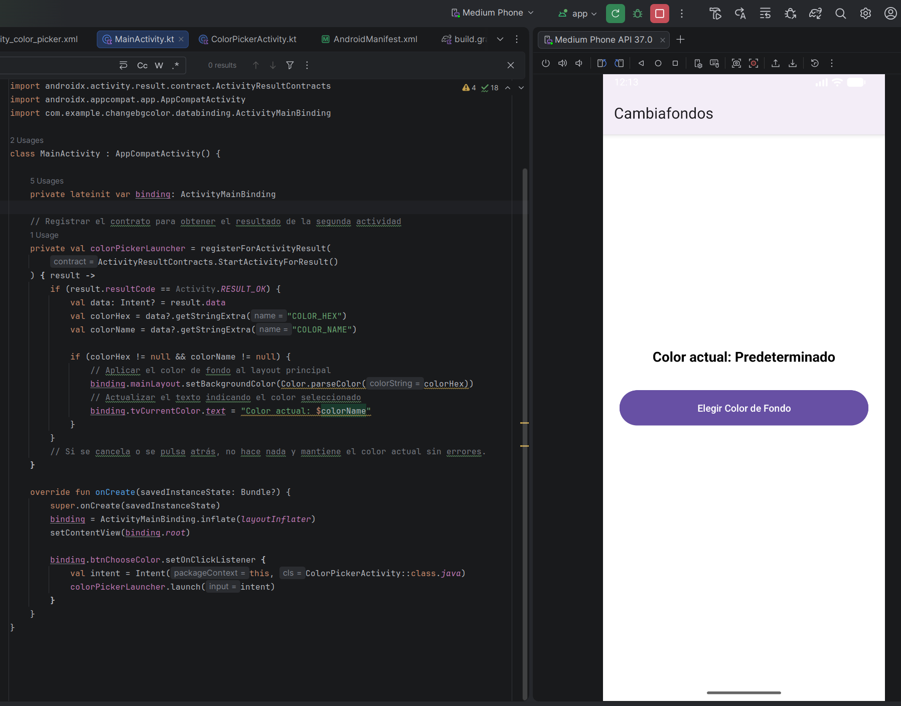
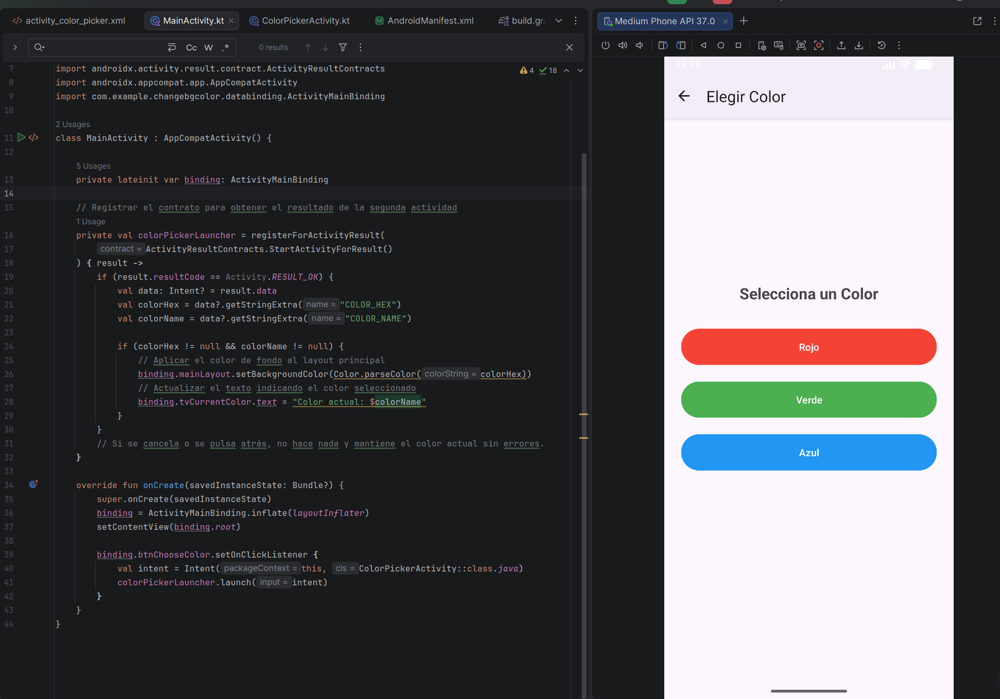
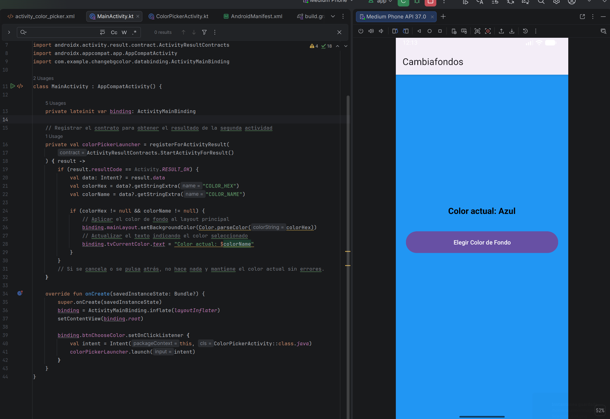

# <center>IES FRANCISCO DE GOYA</center>
__NOMBRE:__ Martin Taboada  
__CURSO:__ DAM 2
## <center> __Programación Multimedia y Dispositivos Móviles:__</center>   <center> __Cambiar Fondo__</center>
A continuación se presentarán evidencias sobre el ejercicio planteado en el aula virtual, se presentarán tanto las imágenes como el texto plano del fragmento del código: 
### __MainActivity.kt__
```
package com.example.changebgcolor

import android.app.Activity
import android.content.Intent
import android.graphics.Color
import android.os.Bundle
import androidx.activity.result.contract.ActivityResultContracts
import androidx.appcompat.app.AppCompatActivity
import com.example.changebgcolor.databinding.ActivityMainBinding

class MainActivity : AppCompatActivity() {

    private lateinit var binding: ActivityMainBinding

    // Registrar el contrato para obtener el resultado de la segunda actividad
    private val colorPickerLauncher = registerForActivityResult(
        ActivityResultContracts.StartActivityForResult()
    ) { result ->
        if (result.resultCode == Activity.RESULT_OK) {
            val data: Intent? = result.data
            val colorHex = data?.getStringExtra("COLOR_HEX")
            val colorName = data?.getStringExtra("COLOR_NAME")

            if (colorHex != null && colorName != null) {
                // Aplicar el color de fondo al layout principal
                binding.mainLayout.setBackgroundColor(Color.parseColor(colorHex))
                // Actualizar el texto indicando el color seleccionado
                binding.tvCurrentColor.text = "Color actual: $colorName"
            }
        }
        // Si se cancela o se pulsa atrás, no hace nada y mantiene el color actual sin errores.
    }

    override fun onCreate(savedInstanceState: Bundle?) {
        super.onCreate(savedInstanceState)
        binding = ActivityMainBinding.inflate(layoutInflater)
        setContentView(binding.root)

        binding.btnChooseColor.setOnClickListener {
            val intent = Intent(this, ColorPickerActivity::class.java)
            colorPickerLauncher.launch(intent)
        }
    }
}
```

### __ColorPockerActivity.kt__
```
package com.example.changebgcolor

import android.app.Activity
import android.content.Intent
import android.os.Bundle
import androidx.appcompat.app.AppCompatActivity
import com.example.changebgcolor.databinding.ActivityColorPickerBinding

class ColorPickerActivity : AppCompatActivity() {

    private lateinit var binding: ActivityColorPickerBinding

    override fun onCreate(savedInstanceState: Bundle?) {
        super.onCreate(savedInstanceState)
        binding = ActivityColorPickerBinding.inflate(layoutInflater)
        setContentView(binding.root)

        supportActionBar?.setDisplayHomeAsUpEnabled(true)
        title = "Elegir Color"

        // Botón Rojo
        binding.btnRed.setOnClickListener {
            devolverColor("#F44336", "Rojo")
        }

        // Botón Verde
        binding.btnGreen.setOnClickListener {
            devolverColor("#4CAF50", "Verde")
        }

        // Botón Azul
        binding.btnBlue.setOnClickListener {
            devolverColor("#2196F3", "Azul")
        }
    }

    private fun devolverColor(hexCode: String, colorName: String) {
        val resultIntent = Intent().apply {
            putExtra("COLOR_HEX", hexCode)
            putExtra("COLOR_NAME", colorName)
        }
        setResult(Activity.RESULT_OK, resultIntent)
        finish() // Cierra la actividad y regresa a MainActivity
    }

    override fun onSupportNavigateUp(): Boolean {
        onBackPressedDispatcher.onBackPressed()
        return true
    }
}
```

### __activity_main.xml__
```
<?xml version="1.0" encoding="utf-8"?>
<LinearLayout xmlns:android="http://schemas.android.com/apk/res/android"
    android:id="@+id/mainLayout"
    android:layout_width="match_parent"
    android:layout_height="match_parent"
    android:orientation="vertical"
    android:gravity="center"
    android:padding="24dp"
    android:background="@android:color/white">

    <TextView
        android:id="@+id/tvCurrentColor"
        android:layout_width="wrap_content"
        android:layout_height="wrap_content"
        android:text="Color actual: Predeterminado"
        android:textSize="20sp"
        android:textStyle="bold"
        android:layout_marginBottom="32dp"
        android:textColor="@android:color/black" />

    <Button
        android:id="@+id/btnChooseColor"
        android:layout_width="match_parent"
        android:layout_height="wrap_content"
        android:text="Elegir Color de Fondo"
        android:padding="16dp" />

</LinearLayout>
```

### __activity_color_picker.xml__
```
<?xml version="1.0" encoding="utf-8"?>
<LinearLayout xmlns:android="http://schemas.android.com/apk/res/android"
    android:layout_width="match_parent"
    android:layout_height="match_parent"
    android:orientation="vertical"
    android:gravity="center"
    android:padding="24dp">

    <TextView
        android:layout_width="wrap_content"
        android:layout_height="wrap_content"
        android:text="Selecciona un Color"
        android:textSize="22sp"
        android:textStyle="bold"
        android:layout_marginBottom="32dp" />

    <Button
        android:id="@+id/btnRed"
        android:layout_width="match_parent"
        android:layout_height="wrap_content"
        android:text="Rojo"
        android:backgroundTint="#F44336"
        android:textColor="@android:color/white"
        android:padding="16dp"
        android:layout_marginBottom="16dp" />

    <Button
        android:id="@+id/btnGreen"
        android:layout_width="match_parent"
        android:layout_height="wrap_content"
        android:text="Verde"
        android:backgroundTint="#4CAF50"
        android:textColor="@android:color/white"
        android:padding="16dp"
        android:layout_marginBottom="16dp" />

    <Button
        android:id="@+id/btnBlue"
        android:layout_width="match_parent"
        android:layout_height="wrap_content"
        android:text="Azul"
        android:backgroundTint="#2196F3"
        android:textColor="@android:color/white"
        android:padding="16dp" />

</LinearLayout>
```

### __AndroidManifest.xml__
```
<?xml version="1.0" encoding="utf-8"?>
<manifest xmlns:android="http://schemas.android.com/apk/res/android">

    <application
        android:allowBackup="true"
        android:icon="@mipmap/ic_launcher"
        android:label="Cambiafondos"
        android:roundIcon="@mipmap/ic_launcher_round"
        android:supportsRtl="true"
        android:theme="@style/Theme.Material3.DayNight">

        <!-- Actividad Principal -->
        <activity
            android:name=".MainActivity"
            android:exported="true">
            <intent-filter>
                <action android:name="android.intent.action.MAIN" />
                <category android:name="android.intent.category.LAUNCHER" />
            </intent-filter>
        </activity>

        <!-- Pantalla de Selección de Color -->
        <activity
            android:name=".ColorPickerActivity"
            android:exported="false"
            android:parentActivityName=".MainActivity" />

    </application>

</manifest>
```

### __Capturas de pantalla del código en funcionamiento__






