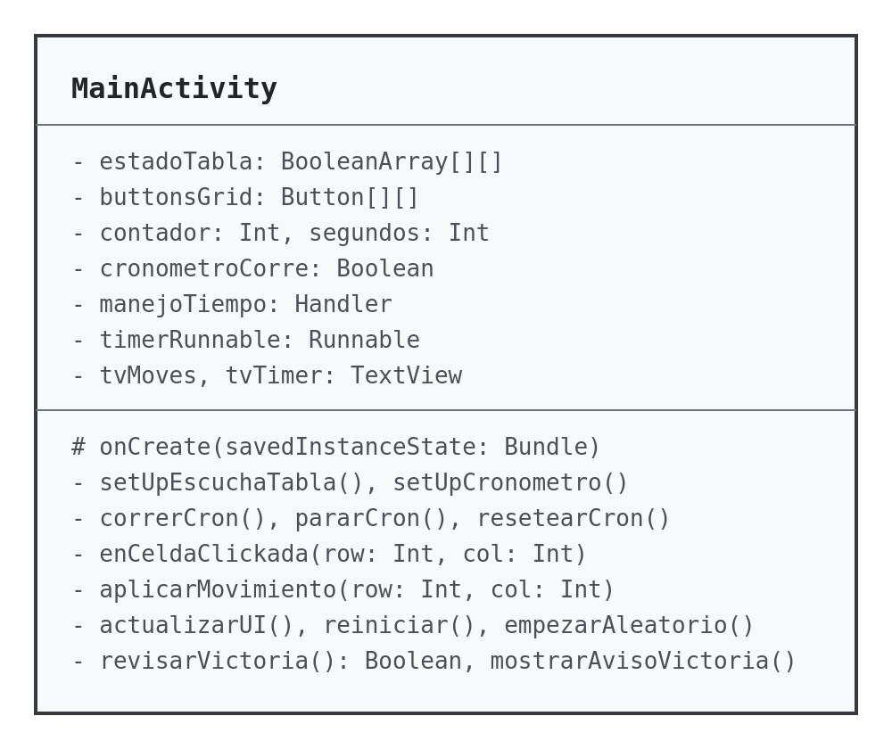
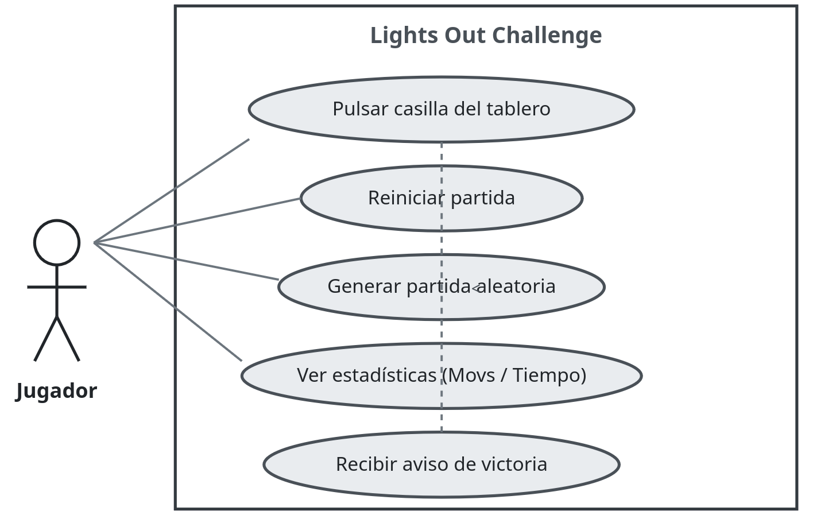
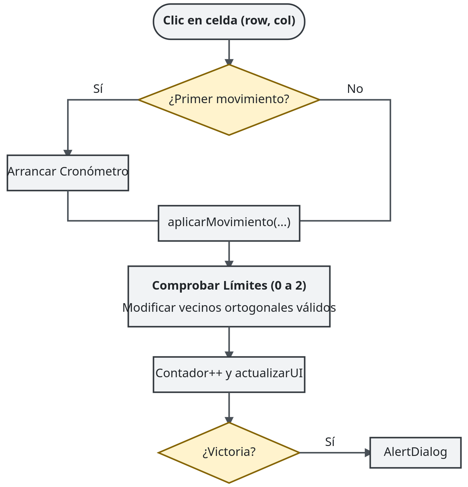
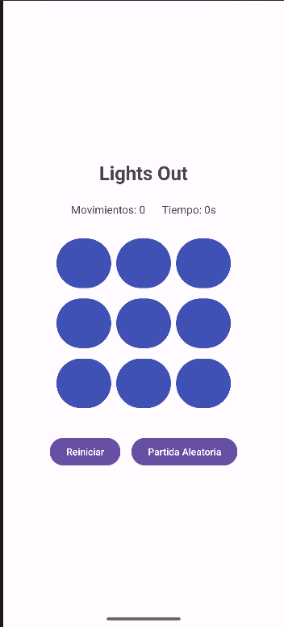
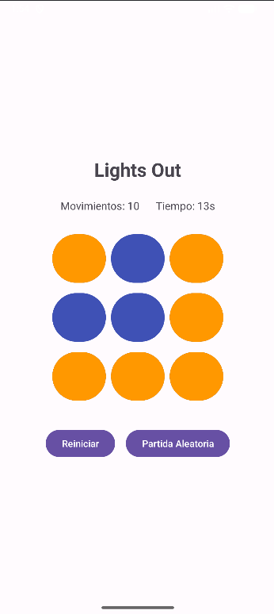
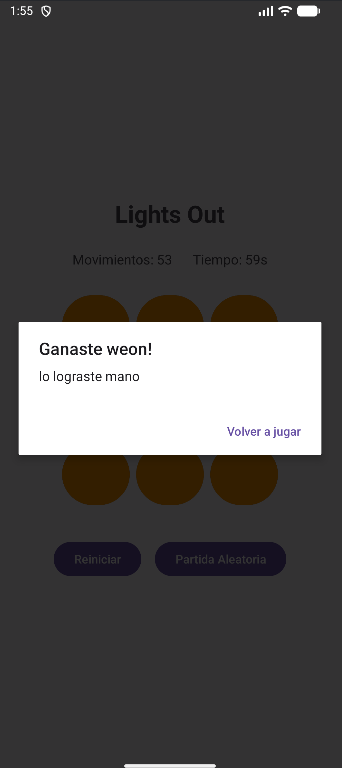

# 
IES FRANCISCO DE GOYA

__NOMBRE:__ Martin Taboada  
__CURSO:__ DAM 2
## 
 __Proyecto Android:__
   
 __Lights Out Challenge__

El presente documento se define en calidad de memoria técnica del proyecto propuesto en el aula virtual, consistente en el desarrollo de una aplicación nativa para Android basada en el clásico juego de puzles Lights Out. A lo largo de esta memoria se detalla la conceptualización del programa, la arquitectura técnica implementada, el análisis lógico de la adyacencia del tablero, la exposición del código real y las mejoras opcionales incorporadas. Asimismo, de manera transparente, se detalla el uso de la Inteligencia Artificial como herramienta de apoyo didáctico y de optimización de tiempos en el flujo de desarrollo.

 

---

## 1. Objetivos

### Planteamiento del problema

El juego Lights Out consiste en una cuadrícula de casillas que pueden encontrarse en dos estados visuales diferentes (encendidas o apagadas). El objetivo del reto es conseguir que todas las casillas alcancen el estado secundario (encendidas) mediante pulsaciones estratégicas. La complejidad radica en que cada vez que se pulsa una casilla, esta altera su propio estado y el de sus cuatro vecinos ortogonales (arriba, abajo, izquierda y derecha), lo que exige planificar los movimientos lógicos.

### Objetivos funcionales y técnicos
- **Interfaz adaptable:** Crear un tablero visual de 3 × 3 casillas interactivas junto a controles de gestión accesibles y un diseño ordenado mediante layouts estándar.
- **Gestión del estado:** Mantener una separación clara entre los datos lógicos de la aplicación (almacenados en una matriz bidimensional) y la representación visual en pantalla.
- **Manejo de eventos:** Capturar las pulsaciones del usuario en cada botón mediante listeners asociados de forma dinámica y eficiente.
- **Algoritmo de adyacencia:** Implementar la lógica matemática que calcula las celdas afectadas asegurando el control estricto de los límites del tablero para evitar excepciones de desbordamiento.
- **Detección de victoria y controles:** Comprobar de forma automática el estado real tras cada movimiento para notificar al usuario y ofrecer mecanismos de reinicio y generación de partidas.

### Mejoras implementadas
Además de los requisitos mínimos obligatorios del puzle, se han desarrollado e integrado tres mejoras opcionales de valor práctico:
1. **Contador de movimientos:** Un registro en tiempo real que contabiliza las interacciones válidas del usuario.
2. **Temporizador:** Un cronómetro basado en hilos (`Handler`) que mide la duración exacta de la partida desde el primer movimiento hasta la victoria.
3. **Partida aleatoria resoluble:** Un generador que parte del tablero resuelto y aplica de forma automática un conjunto aleatorio de movimientos válidos, garantizando al usuario un puzle dinámico pero 100% resoluble.

### Uso de la Inteligencia Artificial
Considerando el entorno laboral actual y los conocimientos adquiridos en el ciclo, se ha empleado la Inteligencia Artificial como herramienta de apoyo y orientación durante el desarrollo del proyecto. Su uso se ha enfocado de manera didáctica para comprender conceptos complejos de programación en Kotlin, estructurar algoritmos eficientes de adyacencia y optimizar tiempos de resolución de errores de compilación, sirviendo como guía de aprendizaje técnico sin sustituir el desarrollo personal del código.

---

## 2. Herramientas

Para llevar a cabo el desarrollo de la aplicación se han utilizado las siguientes herramientas y tecnologías nativas de Android:

- **Android Studio:** Entorno de desarrollo integrado (IDE) oficial para la creación de aplicaciones Android.
- **Kotlin:** Lenguaje de programación principal, moderno, conciso y totalmente interoperable con Java.
- **XML (Views):** Tecnología estándar para la definición de interfaces de usuario mediante layouts tradicionales (`ConstraintLayout`, `LinearLayout` y `GridLayout`).
- **APIs y Clases de Android estándar:** 
  - `Handler` y `Looper` para la gestión temporal del cronómetro en el hilo principal.
  - `AlertDialog` para la notificación interactiva de victoria.
  - `ContextCompat` y `ColorStateList` para la manipulación dinámica de los tintes de color en los botones.
- **Emulador de Android:** Dispositivo virtual configurado en Android Studio para la ejecución, depuración y pruebas unitarias de la interfaz y la lógica.

No se han incorporado bibliotecas externas de terceros, basándose el proyecto por completo en la API estándar de Android para garantizar ligereza y facilidad de mantenimiento.

---

## 3. Diseño

### Diseño de la aplicación
La arquitectura de la aplicación se basa en una única actividad principal (`MainActivity`), encargada de centralizar tanto la lógica de control como la interacción visual. La estructura separa claramente los datos (la matriz booleana del tablero) de la interfaz gráfica (los botones definidos en el archivo XML), conectándose a través de una función centralizada de actualización visual (`actualizarUI()`).

### Representación del tablero
El estado lógico del tablero se modela mediante una matriz bidimensional de tipo booleano de tamaño 3 × 3 (`estadoTabla`):
- `false`: Estado primario (color inicial de la casilla).
- `true`: Estado secundario (color alternativo de la casilla).

Cada posición de la matriz `estadoTabla[row][col]` se corresponde de forma unívoca con un botón específico de la interfaz visual (`buttonsGrid[row][col]`), cuyos identificadores en el XML siguen una nomenclatura matricial correlativa (`btn00` hasta `btn22`).

### Algoritmo de adyacencia
Cuando el usuario pulsa una casilla en la posición `(row, col)`, el sistema ejecuta la función `aplicarMovimiento`, la cual invierte el estado de la casilla seleccionada y evalúa de manera ortogonal a sus cuatro vecinos aplicando comprobaciones de límites estrictas para evitar errores de índice:

1. **Celda pulsada:** `cambiarCelda(row, col)`
2. **Vecino superior:** Se modifica si `row - 1 >= 0`
3. **Vecino inferior:** Se modifica si `row + 1 <= 2`
4. **Vecino izquierdo:** Se modifica si `col - 1 >= 0`
5. **Vecino derecho:** Se modifica si `col + 1 <= 2`

*Ejemplos prácticos:*
- **Pulsación central (`1,1`):** Modifica exactamente 5 celdas (el centro y sus cuatro cruces adyacentes).
- **Pulsación en esquina (`0,0`):** Modifica exactamente 3 celdas (la esquina, la derecha `0,1` y la inferior `1,0`), bloqueando mediante los condicionales los accesos a índices negativos `-1`.

### Diseño UML y casos de uso

*Figura 1: Diagrama simplificado de clases que muestra la estructura de MainActivity y sus métodos principales de control.*

*Figura 2: Diagrama de casos de uso que refleja las acciones disponibles para el usuario (pulsar casillas, reiniciar, generar partida aleatoria).*

 
*Figura 3: Diagrama de flujo del algoritmo de adyacencia y validación de límites.*

---

## 4. Funcionamiento

### Secuencia de ejecución

1. **Estado inicial:** Al arrancar la aplicación, se inicializa `estadoTabla` con valores `false`, el contador a `0` y el cronómetro detenido. La interfaz muestra las 9 casillas pintadas con el color primario (`state_prim`).
2. **Interacción:** Al hacer clic en cualquier botón, se activa el listener que invoca a `enCeldaClickada(row, col)`. Si es el primer movimiento, se arranca el cronómetro de forma automática.
3. **Cálculo y UI:** Se ejecuta `aplicarMovimiento` para invertir los estados lógicos necesarios, se incrementa el contador de movimientos y se llama a `actualizarUI()` para redibujar los colores mediante `backgroundTintList`.
4. **Victoria:** Tras cada movimiento, `revisarVictoria()` evalúa mediante la función `.all` si todas las posiciones de la matriz son verdaderas. En caso afirmativo, se detiene el tiempo y se despliega un `AlertDialog` felicitando al usuario.
5. **Reinicios y aleatoriedad:** El botón "Reiniciar" restablece los datos a cero, mientras que "Partida Aleatoria" aplica un conjunto de movimientos válidos simulados para entregar un reto nuevo y resoluble.

### Capturas de pantalla de la aplicación

  

*Figura 4: Pantalla principal de la aplicación en su estado inicial (todas las casillas en color primario).*

*Figura 5: Estado del tablero tras varios movimientos, mostrando el contador de movimientos y el temporizador en curso.*

*Figura 6: Cuadro de diálogo emergente que notifica la victoria al usuario tras completar el puzle.*

### Pruebas realizadas

Se han llevado a cabo pruebas exhaustivas sobre el emulador para validar los casos clave:
- **Pulsación en esquinas y bordes:** Comprobación satisfactoria de que los límites impiden cierres forzosos de la aplicación.
- **Simetría y reversibilidad:** Verificar que pulsar dos veces una misma casilla deshace los cambios aplicados.
- **Integridad del cronómetro y contador:** Confirmar que la estadística refleja con precisión el esfuerzo del jugador y se resetea correctamente al reiniciar o generar una partida aleatoria.

---

## 5. Conclusiones

### Objetivos cumplidos
El desarrollo de la aplicación *Lights Out Challenge* ha permitido cumplir con éxito todos los requisitos funcionales y técnicos marcados en el enunciado académico. Se ha logrado estructurar una interfaz limpia y adaptativa utilizando Kotlin y XML, implementando una lógica de negocio robusta basada en matrices bidimensionales y un control estricto de adyacencia y límites. 

Asimismo, la incorporación de las mejoras opcionales (temporizador, contador y generador de tableros resolubles) ha aportado un valor añadido significativo que dota a la aplicación de un acabado profesional y completamente funcional.

### Limitaciones técnicas y posibles mejoras futuras
Durante el análisis técnico se ha identificado una limitación inherente al ciclo de vida por defecto de Android: **si el usuario gira la pantalla del dispositivo durante la partida, la `Activity` se destruye y se recrea**, lo que provoca la pérdida volátil del estado actual de la matriz, el contador y el cronómetro. 

Para solventar esta limitación en futuras versiones de la aplicación, se contempla la adopción de los componentes de arquitectura oficiales de Android, específicamente implementando un `ViewModel` para retener de forma segura los datos de la partida ante cambios de configuración del sistema, o bien mediante el uso de los métodos de guardado de estado en instancias (`onSaveInstanceState`).

En definitiva, el proyecto representa una base sólida en el desarrollo móvil nativo y ha cumplido con creces los objetivos didácticos previstos.

