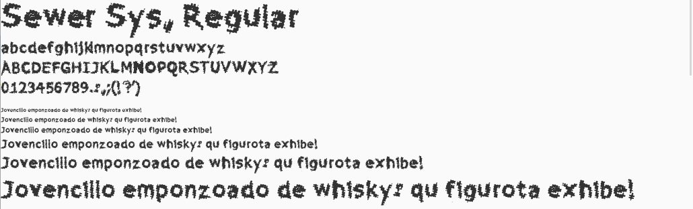
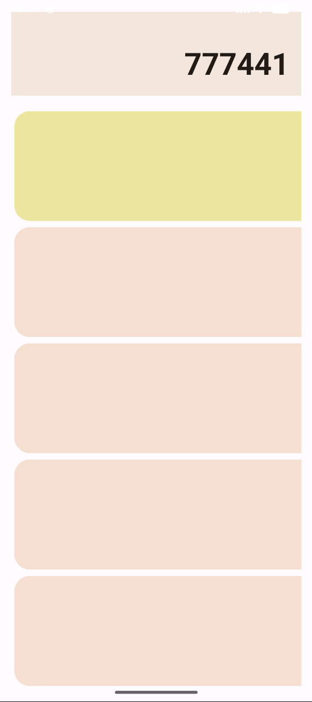
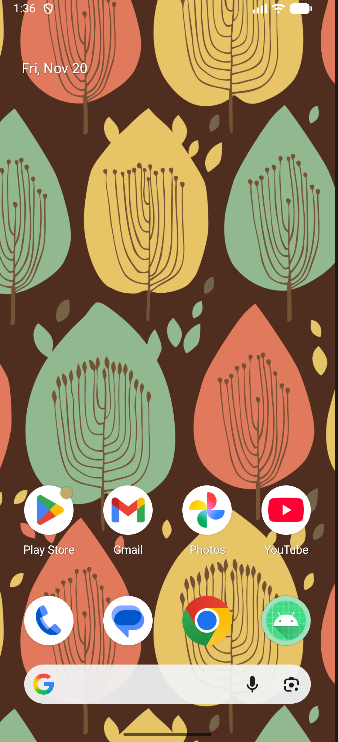

# 
IES FRANCISCO DE GOYA

__NOMBRE:__ Martin Taboada  
__CURSO:__ DAM 2
## 
 __Programación Multimedia y Dispositivos Móviles:__
   
 __SmartCalc__

El presente documento se define en calidad de memoria técnica de la entrega propuesta en el aula virtual: SmartCalc. Una calculadora en la cual se tendrá más en cuenta el desarrollo del aspecto visual. En la presente memoria se detallarán los objetivos, las herramientas utilizadas, el diseño planteado y el funcionamiento junto con problemas iniciales. Además, se detalla, como una herramienta didáctica, el uso de la inteligencia artificial.

 

---

## 1. Objetivos

---
## 2. Herramientas

Observando los recursos otorgados por el docente se ha optado por el uso de [adjuntar herramientas] para que el diseño de los botones cambie acorde a la paleta de colores del mismo fondo de pantalla del dispositivo móvil y para que sea compatible con un cambio de color por el tema oscuro.

---
## 3. Diseño

[Explicar que inicialmente se hizo un boceto de lo que se quería, pero no se tomo en cuenta sino hasta el final con el cambio del redonreo de las esquinas, tambien hablar sobre el fondo de fuente diferente escogida. posteriormente, seguir con lo que está acorde a las disposiciones de la memoria técnica adjuntas ]

---
## 4. Funcionamiento

[Explicar el problema inicial que hubo con respecto a que no se veian los botones bien inicialmente y tambien explicar que mediante la ia se encontró la solucion, posteiormente, seguir con lo acorde a las disposiciones de la memoria tecnica adjunta ]

---
## 5. Conclusiones

che gemini, con las siguientes disposiciones, necesito que generes la memoria tecnica del proyecto de la calculadora, considerando mi manera de redaccion y modificandolo en mi estructura .md que te voy a adjuntar, tambien teniendo en cuenta as anotaciones dentro de la misma, necesito que me lo envies como un markdown descargable, si vas a generar imagenes debido al apartado del diseño mándamelas aparte.

