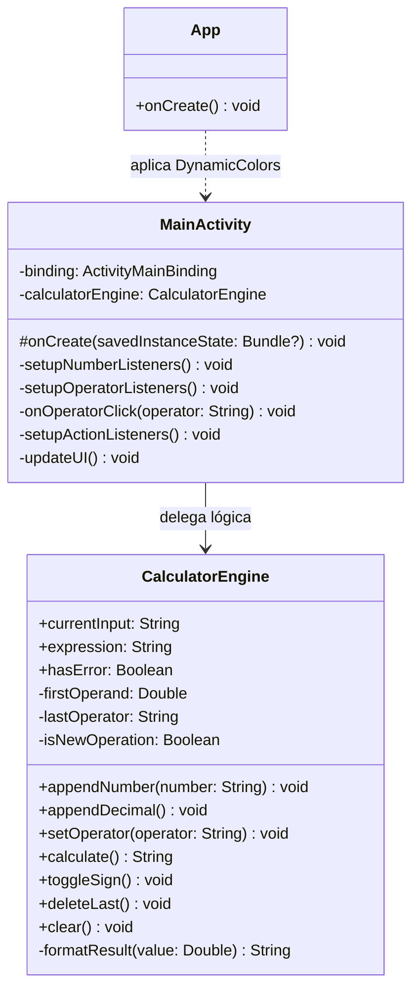
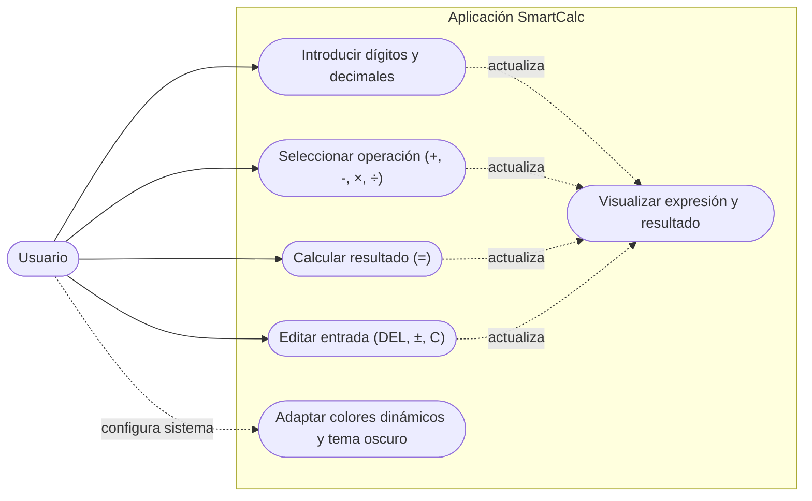
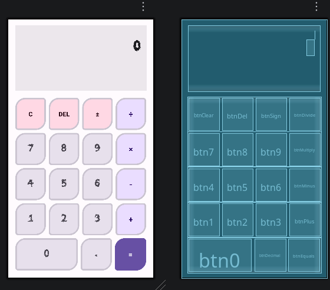
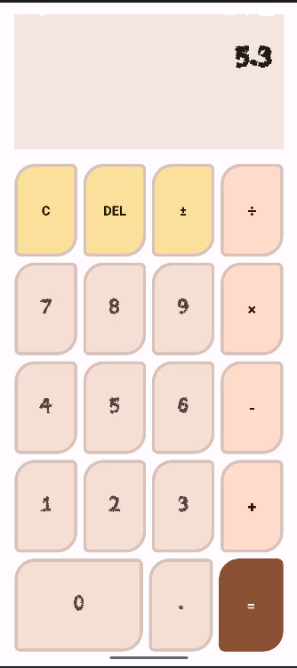
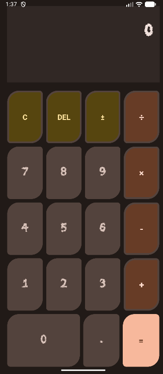
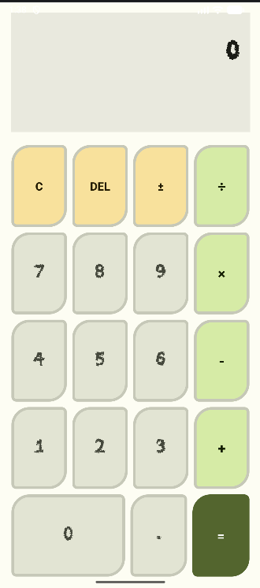

# 
IES FRANCISCO DE GOYA

__NOMBRE:__ Martin Taboada  
__CURSO:__ DAM 2
## 
 __Programación Multimedia y Dispositivos Móviles:__
   
 __SmartCalc__

El presente documento se define en calidad de memoria técnica de la entrega propuesta en el aula virtual: SmartCalc. Una calculadora en la cual se tendrá más en cuenta el desarrollo del aspecto visual. En la presente memoria se detallarán los objetivos, las herramientas utilizadas, el diseño planteado y el funcionamiento junto con problemas iniciales. Además, se detalla, como una herramienta didáctica, el uso de la inteligencia artificial.

A continuación se adjunta el enlace del repositorio del proyecto: [SmartCalc](https://github.com/martinbosquez2015-cmd/SmartCalc)
 

 

---

## 1. Objetivos

El problema propuesto consiste en el desarrollo de una aplicación móvil de calculadora funcional en Android, donde no solo importe la correcta ejecución de las operaciones matemáticas básicas, sino también la calidad de su arquitectura y su acabado visual. El propósito principal es evitar interfaces genéricas o con atributos estéticos repetidos manualmente en cada componente, apostando por una interfaz limpia, coherente y adaptable.

 

Los objetivos específicos que se pretenden conseguir con el proyecto son los siguientes:

* **Separación de responsabilidades:** Desacoplar la lógica matemática y el control de estados de la interfaz gráfica mediante una clase dedicada (`CalculatorEngine`), manteniendo `MainActivity` enfocada únicamente en la gestión de eventos y la actualización de la vista.
* **Control de errores y doble visualización:** Implementar una pantalla doble que muestre tanto la operación en curso como el resultado o entrada actual, controlando errores habituales como la división por cero o la introducción de múltiples puntos decimales en una misma cifra.
* **Centralización de estilos:** Definir todos los atributos visuales en archivos de recursos (`styles.xml` y `themes.xml`), categorizando los botones según su función (numéricos, operadores, acciones especiales e igual).
* **Mejoras visuales e integración con el sistema:** Como mejora añadida sobre los requisitos básicos, se implementa la adaptación dinámica de colores según el fondo de pantalla del usuario (Material You), soporte nativo para modo claro y oscuro, personalización asimétrica de las esquinas de los componentes y el uso de una tipografía personalizada.

---

## 2. Herramientas

Observando los recursos otorgados por el docente se ha optado por el uso de la librería <b>Material Components for Android (Material Design 3)</b> y su API de colores dinámicos (<code>DynamicColors</code>) para que el diseño de los botones cambie acorde a la paleta de colores del mismo fondo de pantalla del dispositivo móvil y para que sea compatible con un cambio de color por el tema oscuro.

 

En conjunto, el entorno y las tecnologías empleadas fuera de la API más básica del sistema son:

* **Android Studio & Kotlin:** Entorno de desarrollo oficial y lenguaje de programación principal del proyecto, aprovechando su seguridad frente a nulos y sintaxis concisa.
* **View Binding:** Herramienta activada en Gradle para vincular de forma segura y directa los componentes XML con el código Kotlin sin recurrir a llamadas repetitivas de `findViewById`.
* **Material Design 3 (`com.google.android.material`):** Empleada para los componentes `MaterialButton` y `MaterialCardView`, el sistema de tokens de color (`?attr/colorPrimary`, `?attr/colorSurfaceContainerHigh`, etc.) y `DynamicColors.applyToActivitiesIfAvailable()`, logrando que la paleta cromática se genere dinámicamente a partir del fondo de pantalla en dispositivos con Android 12 o superior.
* **ConstraintLayout y LinearLayout anidados:** Utilizados para estructurar la pantalla de visualización y distribuir equitativamente el teclado mediante pesos (`layout_weight`).
* **Recursos de fuentes (`res/font`) y `ShapeAppearanceOverlay`:** Utilizados para incorporar una tipografía distinta a la predeterminada y moldear individualmente el radio de cada esquina en botones y contenedores.
* **Inteligencia Artificial (Gemini):** Empleada como herramienta didáctica de apoyo para la resolución de problemas de renderizado en el layout, la consulta de tokens de Material 3 y la redacción estructurada de esta documentación.

---

## 3. Diseño

Inicialmente se planteó un boceto conceptual de la interfaz buscando alejarse del aspecto rectangular y plano que ofrecen los botones por defecto en Android Studio. Aunque en una primera fase se priorizó levantar la estructura funcional, ese planteamiento estético se retomó y materializó en la recta final del desarrollo mediante la personalización selectiva de las esquinas (aplicando radios distintos en esquinas opuestas mediante <code>shapeAppearanceOverlay</code> tanto en los botones como en el contenedor de la pantalla) y la incorporación de una fuente tipográfica diferente en la carpeta de recursos (<code>res/font</code>) junto con cifras tabulares para dar mayor personalidad y claridad a los números.

 

### Diagrama de Clases (UML)

A nivel arquitectónico, el proyecto se divide en tres clases principales para garantizar el bajo acoplamiento entre la inicialización del tema dinámico, la interfaz de usuario y el motor de cálculo:

### Diagrama de Casos de Uso

El usuario interactúa directamente con la interfaz principal de SmartCalc para realizar cálculos aritméticos, gestionar la entrada de datos y beneficiarse de la adaptación visual del sistema:

---

## 4. Funcionamiento

Durante la fase de implementación surgió un problema inicial relevante con la visualización del teclado: al emplear un <code>GridLayout</code> estándar con pesos en las columnas, el primer botón de cada fila se estiraba ocupando todo el ancho disponible, empujando al resto de botones fuera de la pantalla y ocultando su texto. Tras analizar el fallo implementando un apoyo en la inteligencia artificial como herramienta de consulta, se identificó el conflicto de distribución y se sustituyó el contenedor por una estructura de <code>LinearLayout</code> horizontales anidados con <code>layout_weight="1"</code>, corrigiendo además los márgenes internos de <code>MaterialButton</code>. De este modo, todos los botones quedaron perfectamente alineados y visibles.

 

Una vez resuelta la maquetación, el funcionamiento de la aplicación abarca todas las operaciones requeridas:

* **Entrada numérica y decimal:** Al pulsar los dígitos (`0-9`), `CalculatorEngine` concatena las cifras evitando ceros innecesarios a la izquierda. El botón `.` comprueba si la cifra actual ya contiene un separador decimal para impedir valores inválidos como `12.3.4`.
* **Operaciones aritméticas y doble pantalla:** Al seleccionar `+`, `-`, `×` o `÷`, se almacena el primer operando y se refleja la expresión en curso en el `TextView` superior (`tvExpression`), dejando el principal (`tvResult`) preparado para el siguiente número. Al pulsar `=`, se muestra la operación completa arriba y el resultado formateado abajo.
* **Acciones de control (`C`, `DEL`, `±`):** Permiten reiniciar por completo el estado de la calculadora, borrar el último carácter introducido o invertir el signo del número actual.
* **Control de errores:** Si se intenta dividir entre cero, el motor captura la condición antes de ejecutar la división, activa el estado de error y muestra el mensaje `"Error: Div por 0"` sin que la aplicación se cierre, reiniciándose automáticamente en la siguiente pulsación.
* **Adaptación dinámica de color y tema:** Como se aprecia en las siguientes capturas, al modificar el fondo de pantalla del dispositivo o activar el modo oscuro del sistema, la interfaz recalcula automáticamente los tonos de contenedores, texto y botones manteniendo la legibilidad y coherencia estética.

 

---

## 5. Conclusiones

Se han cumplido satisfactoriamente todos los objetivos técnicos y visuales propuestos para SmartCalc. La calculadora realiza con precisión las operaciones aritméticas exigidas, gestiona correctamente los errores de entrada y división por cero, y mantiene una arquitectura limpia gracias a la separación entre <code>MainActivity</code> y <code>CalculatorEngine</code>. Asimismo, la centralización de estilos en XML junto con Material Design 3 ha permitido lograr una interfaz moderna, con esquinas personalizadas, tipografía cuidada y adaptación automática tanto al fondo de pantalla como al modo oscuro del dispositivo.

 

Como posibles mejoras futuras para ampliar la aplicación se observan las siguientes líneas de trabajo:

* **Soporte para operaciones encadenadas y paréntesis:** Ampliar `CalculatorEngine` para evaluar expresiones completas con jerarquía de operadores en lugar de limitarse a pares de operandos.
* **Historial de cálculos:** Añadir un panel deslizable o diálogo donde el usuario pueda consultar y reutilizar resultados de operaciones anteriores.
* **Funciones científicas y porcentaje:** Incorporar botones adicionales para cálculo de porcentajes (`%`), potencias o raíces cuadradas manteniendo la coherencia con los estilos definidos.

