# <center>IES FRANCISCO DE GOYA</center>
__NOMBRE:__ Martin Taboada  
__CURSO:__ DAM 2  
 
## <center> __Desarrollo de interfaces:__</center>   <center> __Smart Room Voice Control__</center>

<div align="justify">El presente documento se define en calidad de memoria técnica y dossier de pruebas del proyecto propuesto en el aula virtual para el módulo de Desarrollo de Interfaces, consistente en el desarrollo de la lógica de control de una aplicación web interactiva que simula la domótica de una habitación inteligente mediante comandos de voz y entrada manual. A lo largo de esta memoria se detalla la conceptualización del sistema, la arquitectura de procesamiento de lenguaje natural básico implementada en JavaScript, la gestión del estado de la interfaz, las funcionalidades adicionales incorporadas (Modo Verano y comandos ocultos) y el registro visual de las pruebas funcionales realizadas.</div>

<br>

---

## 1. Objetivos

### Planteamiento del problema
<div align="justify">
El proyecto <i>Smart Room Voice Control</i> parte de una interfaz gráfica web y un motor base de reconocimiento de voz ya integrados. El objetivo principal consiste en programar la lógica necesaria en <code>app.js</code> para interpretar las órdenes del usuario —sin depender de frases rígidas o exactas—, validar los parámetros recibidos y actualizar de forma coherente tanto el estado interno de la habitación como su representación visual en pantalla.
</div>

### Objetivos funcionales y técnicos
- **Estado inicial controlado:** Garantizar que, al iniciar o reiniciar la aplicación, la estancia parta siempre de una configuración base: luz apagada, persiana abierta, temperatura a $22^{\circ}\text{C}$ y modo noche desactivado.
- **Interpretación flexible de comandos:** Descomponer la cadena de texto recibida identificando acciones (<i>encender, apagar, abrir, cerrar, subir, bajar</i>), elementos (<i>luz, persiana, temperatura</i>) y valores numéricos asociados mediante arrays de palabras clave y expresiones regulares.
- **Gestión de estado y validación:** Controlar la coherencia de las acciones para evitar operaciones redundantes (como encender una luz ya encendida) y restringir los valores térmicos al rango operativo permitido ($16^{\circ}\text{C}$ a $30^{\circ}\text{C}$), ofreciendo retroalimentación clara al usuario ante cualquier error.
- **Modos preconfigurados y personalización:** Implementar el <i>Modo Noche</i> estándar, el comando de reinicio global y diseñar un <i>Modo Verano</i> personalizado junto a interacciones adicionales que enriquezcan la experiencia de usuario.

<br>

---

## 2. Arquitectura y Lógica Implementada

<div align="justify">
Para lograr un código modular, legible y escalable, la lógica de <code>app.js</code> se ha estructurado mediante funciones específicas encargadas de evaluar las intenciones del usuario antes de mutar el estado global de la interfaz.
</div>

### Extracción de valores numéricos y control térmico
<div align="justify">
En el procesamiento de órdenes relativas a la temperatura, en lugar de recurrir a diccionarios extensos de conversión texto-entero, se ha optado por el uso de expresiones regulares (<code>/\d+/</code>) combinadas con funciones auxiliares de coincidencia de vocabulario (<code>entraEnAlguna</code>). De este modo, el sistema extrae dinámicamente cualquier cifra incluida en el comando (estableciendo <code>1</code> como incremento o decremento por defecto si no se especifica cantidad) y valida que el resultado final se mantenga estrictamente dentro del umbral de seguridad de 16°C a 30°C.
</div>

```javascript
else if (texto.includes("temperatura")) {
  const coincidencia = texto.match(/\d+/);
  const numero = coincidencia ? Number(coincidencia[0]) : 1;

  if (entraEnAlguna(texto, palabrasSubir)) {
    ponerNuevaTemperatura(temp + numero);
  } else if (entraEnAlguna(texto, palabrasBajar)) {
    ponerNuevaTemperatura(temp - numero);
  } else if (entraEnAlguna(texto, palabrasPoner)) {
    if (coincidencia) {
      ponerNuevaTemperatura(numero);
    } else {
      informar("¿A cuántos grados quieres ponerla?", true);
    }
  }
}
```

### Implementación de Modos Especiales (Modo Noche y Modo Verano)
<div align="justify">
Además del <b>Modo Noche</b> obligatorio —que apaga la iluminación, cierra la persiana, ajusta el termostato a 20°C y aplica el tema oscuro en la interfaz—, se ha diseñado e implementado un modo personalizado denominado <b>Modo Verano</b>. Al activarse mediante voz o texto, este perfil ejecuta cuatro acciones simultáneas sobre el entorno:
</div>

1. **Iluminación:** Enciende la luz de la habitación.
2. **Persianas:** Cierra las persianas para bloquear el exceso de radiación solar.
3. **Climatización:** Establece la temperatura al mínimo permitido ($16^{\circ}\text{C}$) para refrescar la estancia.
4. **Ambientación visual:** Modifica dinámicamente el fondo de la habitación cargando un recurso animado (GIF) acorde a la temática estival.

### Mejoras opcionales: Comandos contextuales y Easter Eggs
<div align="justify">
Con el objetivo de dotar a la interfaz de mayor naturalidad y cercanía, se ha desarrollado la función <code>easterEggs(texto)</code>, ejecutada como filtro prioritario en el análisis de comandos. Esta función permite al sistema responder con mensajes coloquiales ante expresiones de cortesía (<i>"gracias"</i>, <i>"por favor"</i>, elogios a la habitación) y ejecutar ajustes térmicos automáticos ante expresiones naturales de sensación térmica como <i>"tengo calor"</i> o <i>"tengo frío"</i>, variando la temperatura en °C.

</div>

<br>

---

## 3. Pruebas Funcionales Realizadas

<div align="justify">
A continuación, se documenta la batería de pruebas ejecutadas tanto mediante reconocimiento de voz como a través de la entrada de texto manual, verificando el correcto comportamiento de cada funcionalidad obligatoria, la gestión de errores y los modos personalizados.
</div>

### 3.1. Estado inicial de la habitación
* **Descripción:** Carga inicial de la aplicación web.
* **Resultado esperado:** Luz apagada, persiana abierta, temperatura en $22^{\circ}\text{C}$ y modo noche desactivado.


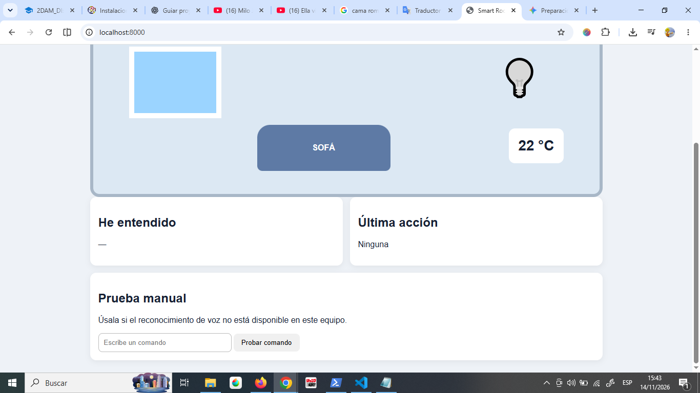
---

### 3.2. Control de iluminación (Encender y Apagar)
* **Comandos probados:** *"Enciende la luz"* / *"Apagar la luz"*.
* **Resultado esperado:** Cambio visual del estado de la bombilla e iluminación de la estancia, junto con el mensaje de confirmación correspondiente.

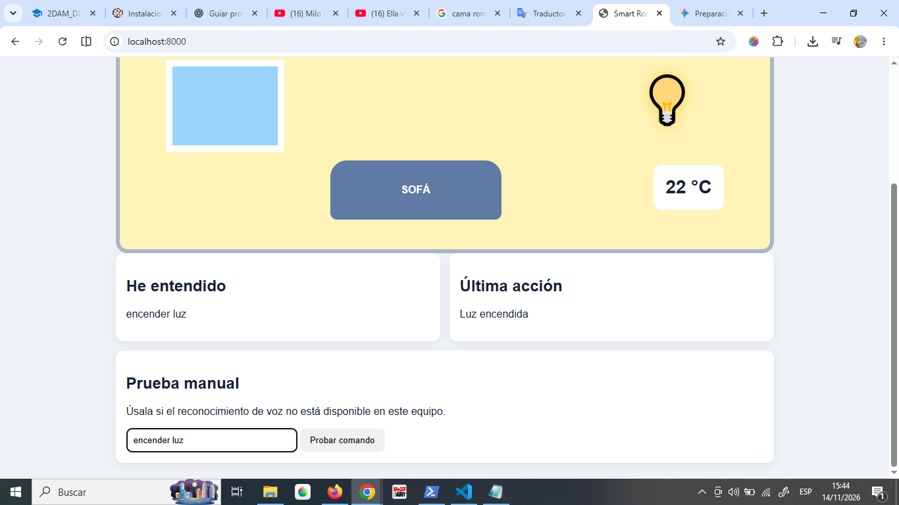

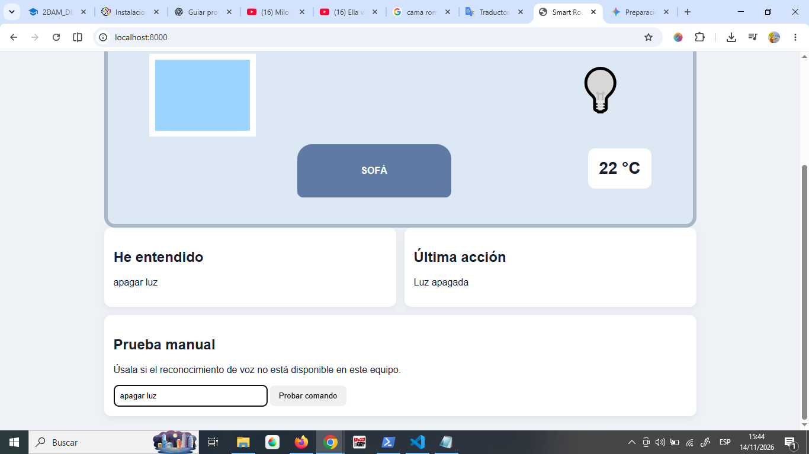

---

### 3.3. Control de persianas (Abrir y Cerrar)
* **Comandos probados:** *"Cierra la persiana"* / *"Abrir la persiana"*.
* **Resultado esperado:** Despliegue o recogida visual de la persiana en la ventana de la interfaz y actualización del estado interno.

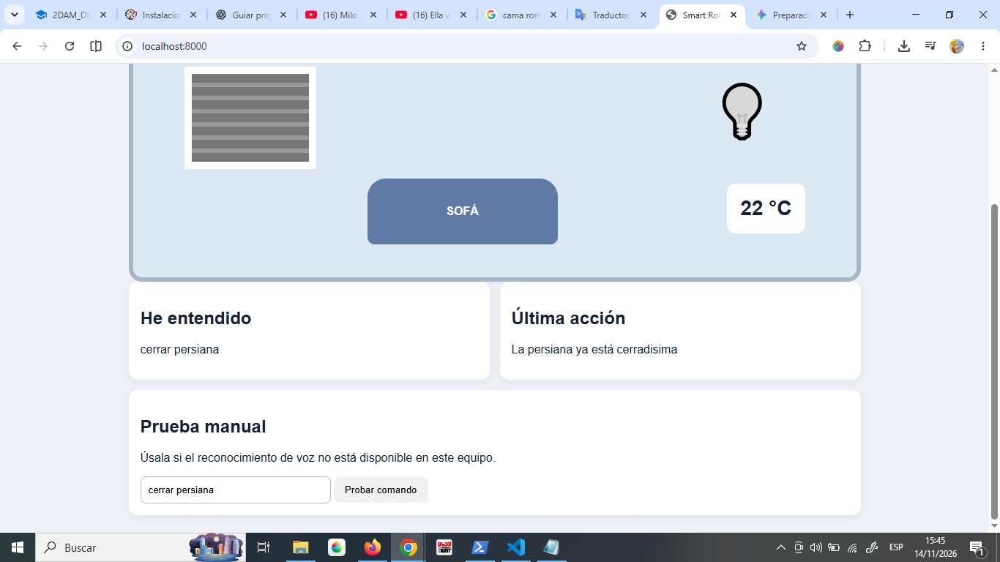
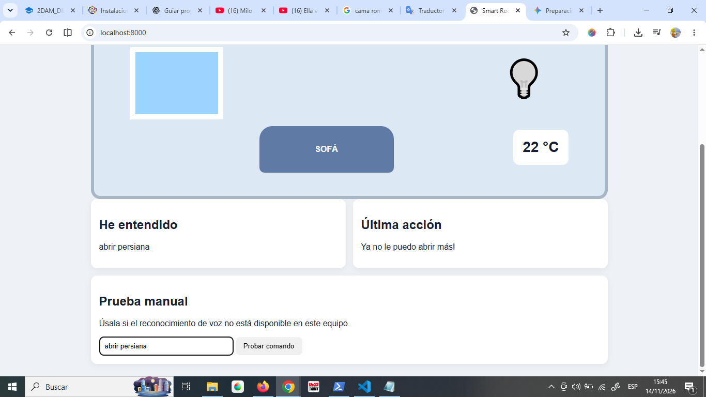

---

### 3.4. Control de temperatura (Subir, Bajar y Establecer)
* **Comandos probados:** *"Sube la temperatura 2 grados"*, *"Baja la temperatura 3 grados"*, *"Pon la temperatura a 24 grados"*.
* **Resultado esperado:** Actualización exacta del indicador numérico de temperatura dentro del rango válido.

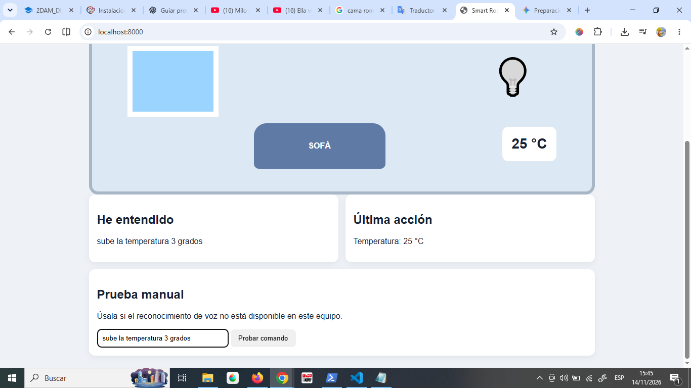
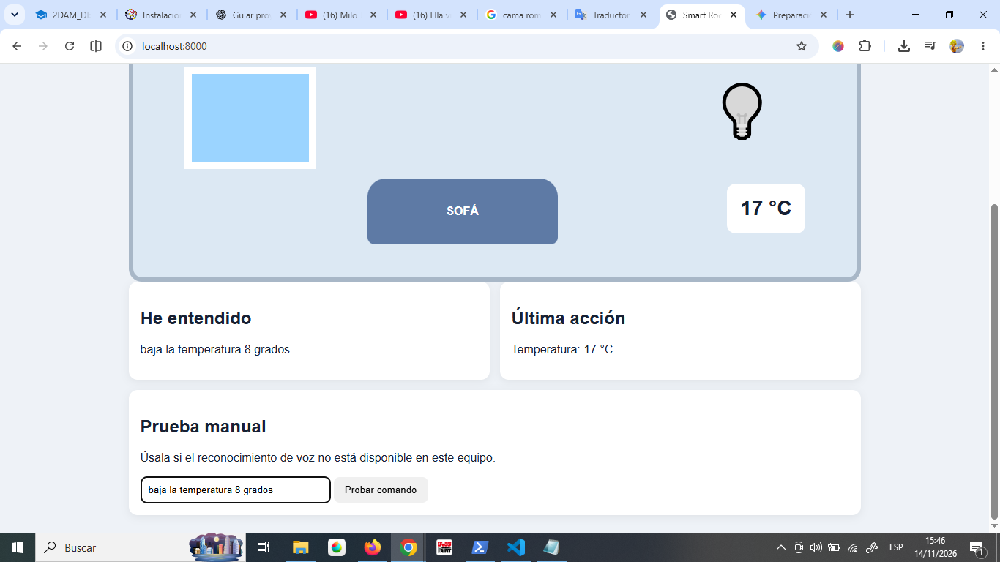
---

### 3.5. Validación de límites y gestión de errores
* **Comandos probados:** Intentar establecer temperatura fuera de rango (ej. *"Pon la temperatura a 35 grados"*), repetir una acción ya aplicada (ej. abrir la persiana estando abierta) e introducir un comando no reconocido.
* **Resultado esperado:** El sistema bloquea la acción inválida, mantiene el estado anterior y muestra un mensaje informativo o de error claro en pantalla.

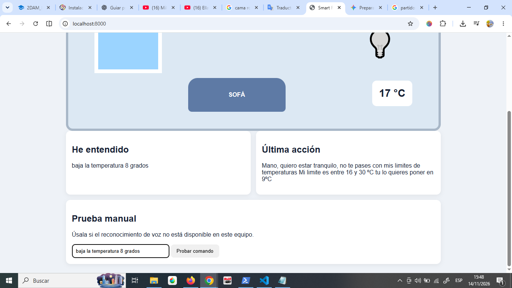

---

### 3.6. Activación del Modo Noche
* **Comando probado:** *"Activar modo noche"*.
* **Resultado esperado:** Luz apagada, persiana cerrada, temperatura fijada en $20^{\circ}\text{C}$ y activación del estilo visual nocturno.

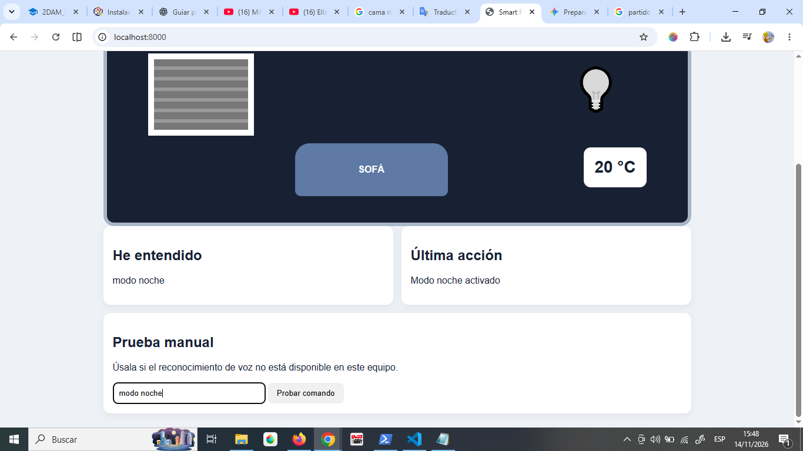

---

### 3.7. Activación del Modo Personalizado (Modo Verano)
* **Comando probado:** *"Activar modo verano"*.
* **Resultado esperado:** Luz encendida, persiana cerrada, temperatura ajustada a $16^{\circ}\text{C}$ y cambio del fondo de la habitación al GIF animado configurado.

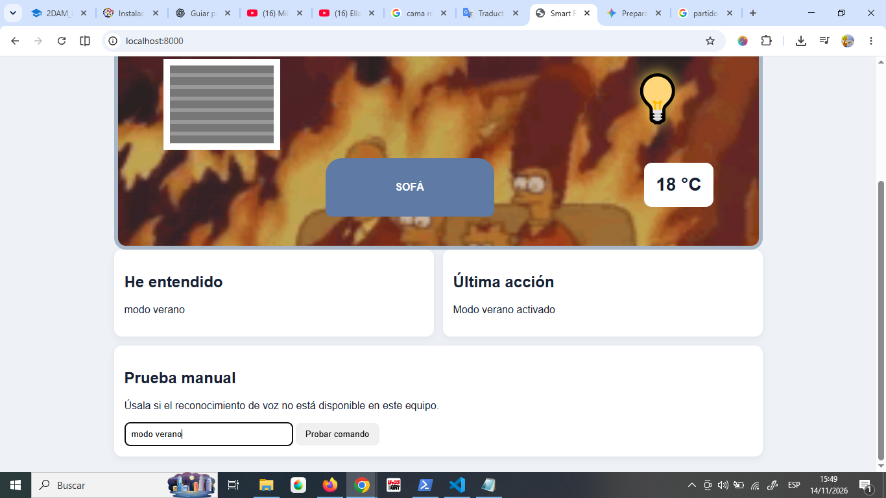
---

### 3.8. Comando de reinicio de habitación
* **Comando probado:** *"Reiniciar habitación"*.
* **Resultado esperado:** Restauración completa de los parámetros originales (luz apagada, persiana abierta, $22^{\circ}\text{C}$, modos especiales desactivados).

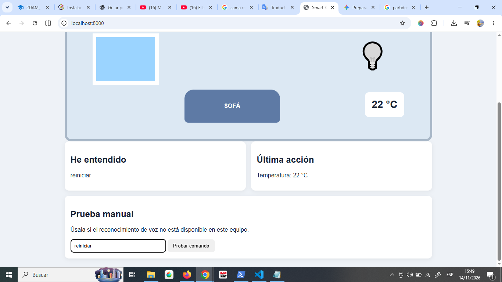

---

### 3.9. Pruebas de mejoras adicionales (Easter Eggs y comandos naturales)
* **Comandos probados:** *"Tengo calor"*, *"Tengo frío"*, *"Gracias"*.
* **Resultado esperado:** Ajuste automático de $\pm 1^{\circ}\text{C}$ en los comandos térmicos naturales y respuesta personalizada en pantalla.


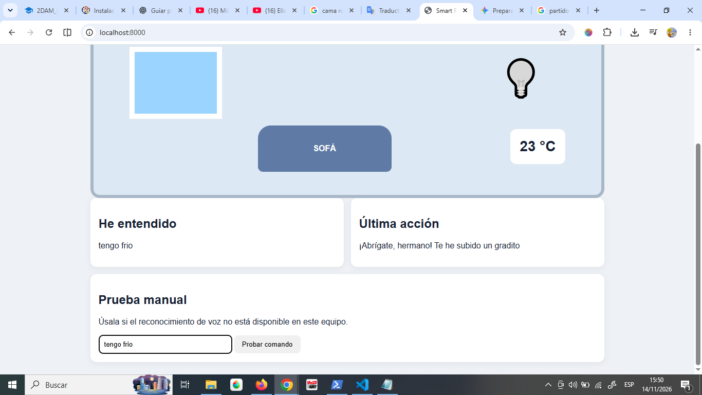