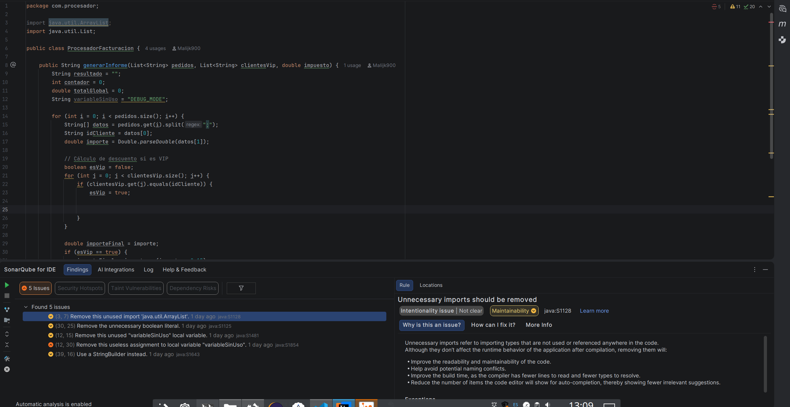
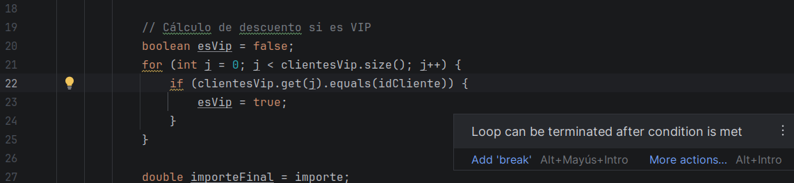
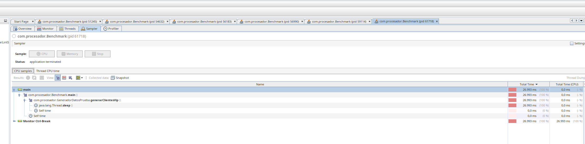
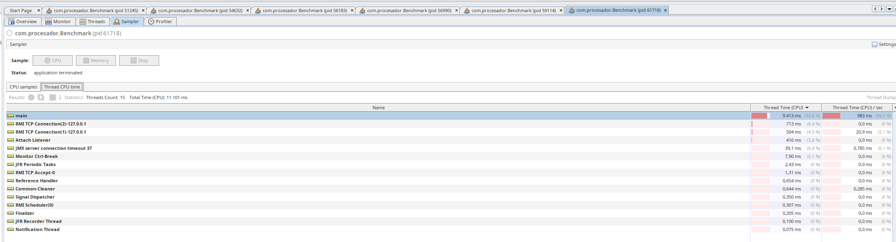
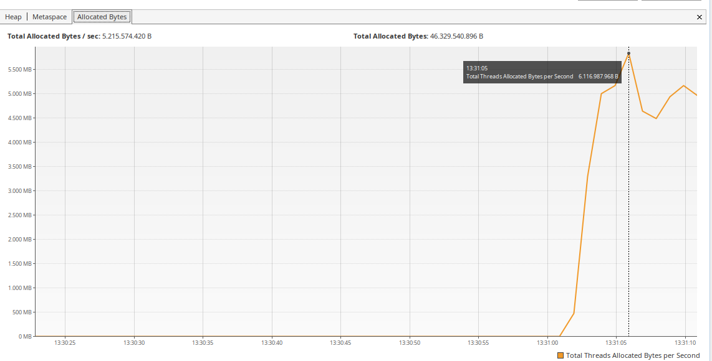
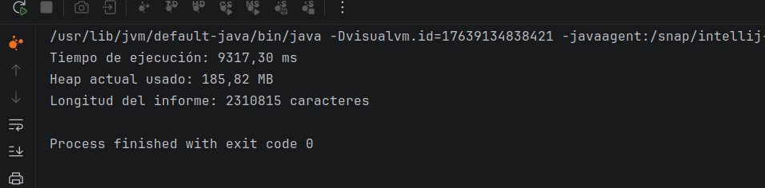
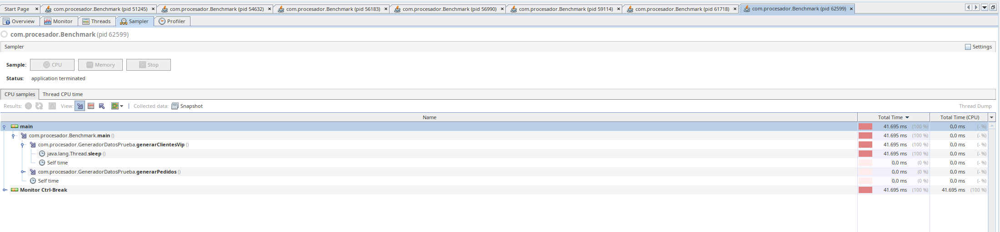
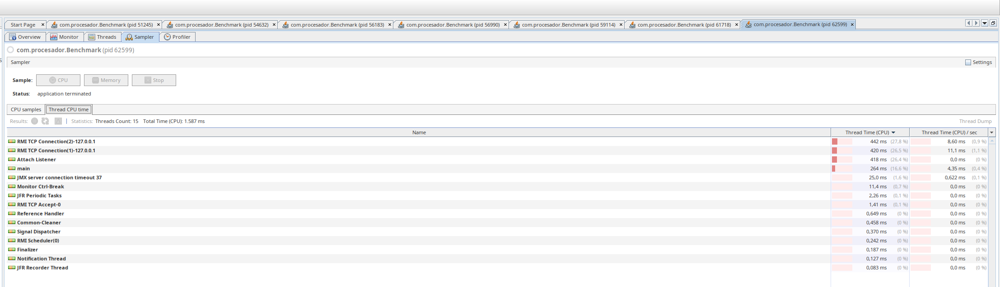
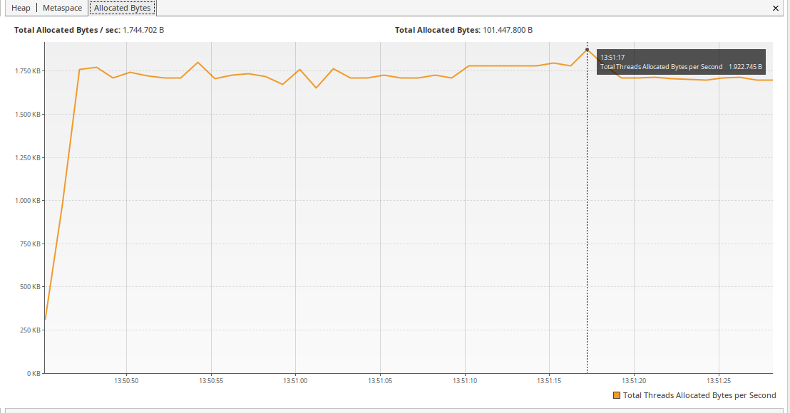
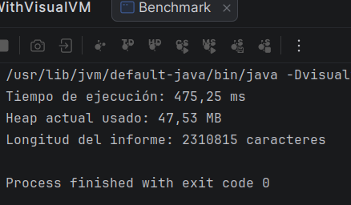

# Informe Técnico: Optimización de `ProcesadorFacturacion`

## 1. Resumen ejecutivo
Se diagnosticó y optimizó `ProcesadorFacturacion` sobre un dataset de 50.000 pedidos y 10.000 clientes, manteniendo la salida textual 100 % idéntica (`equals == true`).

## 2. Hallazgos del análisis estático

- Problemas detectados: variable sin usar, concatenación de `String` en bucle, condición booleana redundante (`esVip == true`), importación sin usar y búsqueda lineal anidada. Debido a que SonarQube no detectaba más problemas como la busqueda lineal anidada(detectada por el mismo IDE), tambien se adjunta esa detección

## 3. Diagnóstico con Profiler (Antes vs. Después)
- **CPU (Antes):** 

- **Memoria (Antes):** 

- **Resultado impreso (Antes):** 

- **Después:** 

    **Resultado impreso** 

    

## 4. Refactorizaciones aplicadas
- Extracción de constantes (`DESCUENTO_VIP`, `UMBRAL_IMPORTE`) y eliminación de código muerto.
- Reemplazo de búsqueda lineal por `HashSet` ($O(1)$ promedio) y `String` por `StringBuilder`.
- Extracción de métodos auxiliares (`calcularImporteFinal`, `appendLineaPedido`).

## 5. Tabla comparativa de métricas

| Métrica Evaluada | Versión Inicial | Versión Optimizada | Mejora (%) | Herramienta del IDE utilizada |
| :--- | :--- | :--- | :--- | :--- |
| Tiempo de ejecución (ms) |9317.30 |475.25 | | |
| Memoria máxima asignada (MB) | 185.82| 47.53| | |
| Nº de *Warnings / Code Smells* | 5 | 0 | | |
| Complejidad ciclomática del método principal | | | | |

## 6. Verificación funcional
Se comprobó con aserción/comparación directa que la cadena devuelta por la versión optimizada es idéntica a la de la versión original.