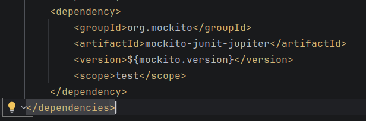
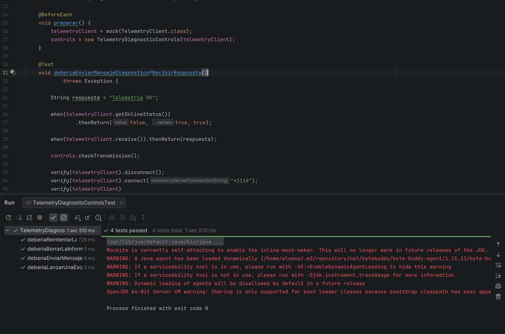

# <center>IES FRANCISCO DE GOYA</center>
__NOMBRE:__ Martin Taboada  
__CURSO:__ DAM 2
## <center> __Entornos de Desarrollo:__</center>   <center> __Coches de Carreras__</center>
A continuación se presentarán evidencias sobre el ejercicio planteado en el aula virtual, se presentarán tanto las imágenes como el texto plano del fragmento del código, además de la explicación de los cambios realizados. Previa a la evidenciación se explicarán unos cambios a realizar dentro del proyecto que fueron necesarios
- El primer punto a tomar en cuenta es que, como fue explicado mockito en clase, el mismo ejercicio sugiere utilizarlo. por lo que se comprobará si dentro del pom.xml se encuentra a mockito como dependencia: 


- Como segundo punto, habrá que modificar parte de ```TelemetryDiagnosticControls.java``` para la inserción del mock:
```
  public TelemetryDiagnosticControls(TelemetryClient telemetryClient) {
            this.telemetryClient = telemetryClient;
        }
        
```
&emsp;&emsp;&emsp;&emsp; Este constructor se añadirá, pero no reemplazará el constructor de la clase, para ser consecuentes con el código original.

- El tercer punto será la creación de los test, que se mostrarán a continuacion:
```
package tddmicroexercises.telemetrysystem;

import org.junit.jupiter.api.BeforeEach;
import org.junit.jupiter.api.Test;

import static org.junit.jupiter.api.Assertions.*;
import static org.mockito.Mockito.*;

class TelemetryDiagnosticControlsTest {

    private TelemetryClient telemetryClient;
    private TelemetryDiagnosticControls controls;

    @BeforeEach
    void preparar() {
        telemetryClient = mock(TelemetryClient.class);
        controls = new TelemetryDiagnosticControls(telemetryClient);
    }

    @Test
    void deberiaEnviarMensajeDiagnosticoYRecibirRespuesta()
            throws Exception {

        String respuesta = "Telemetría OK";

        when(telemetryClient.getOnlineStatus())
                .thenReturn(false, true, true);

        when(telemetryClient.receive()).thenReturn(respuesta);

        controls.checkTransmission();

        verify(telemetryClient).disconnect();
        verify(telemetryClient).connect("*111#");
        verify(telemetryClient)
                .send(TelemetryClient.DIAGNOSTIC_MESSAGE);
        verify(telemetryClient).receive();

        assertEquals(respuesta, controls.getDiagnosticInfo());
    }

    @Test
    void deberiaReintentarLaConexionCuandoFallaElPrimerIntento()
            throws Exception {

        when(telemetryClient.getOnlineStatus())
                .thenReturn(false, false, true, true);

        when(telemetryClient.receive())
                .thenReturn("Telemetría OK");

        controls.checkTransmission();

        verify(telemetryClient, times(2))
                .connect("*111#");

        verify(telemetryClient)
                .send(TelemetryClient.DIAGNOSTIC_MESSAGE);

        assertEquals("Telemetría OK", controls.getDiagnosticInfo());
    }

    @Test
    void deberiaLanzarUnaExcepcionCuandoLaConexionFallaTresVeces() {

        when(telemetryClient.getOnlineStatus())
                .thenReturn(false);

        Exception excepcion = assertThrows(
                Exception.class,
                () -> controls.checkTransmission()
        );

        assertEquals("Unable to connect.", excepcion.getMessage());

        verify(telemetryClient, times(3))
                .connect("*111#");

        verify(telemetryClient, never()).send(anyString());
        verify(telemetryClient, never()).receive();
    }

    @Test
    void deberiaBorrarLaInformacionDiagnosticaAnteriorAntesDeComprobar()
            throws Exception {

        controls.setDiagnosticInfo("Información anterior");

        when(telemetryClient.getOnlineStatus())
                .thenReturn(false, true, true);

        when(telemetryClient.receive())
                .thenReturn("Información nueva");

        controls.checkTransmission();

        assertEquals("Información nueva", controls.getDiagnosticInfo());
    }
}
```
- Finalmente, a continaución se presentará la captura del éxito de las pruebas:
