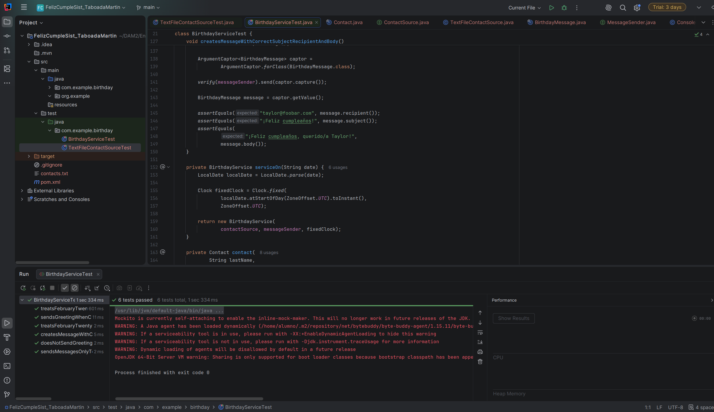
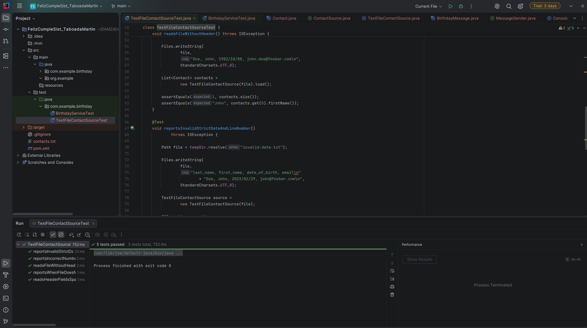

# 
IES FRANCISCO DE GOYA

__NOMBRE:__ Martin Taboada  
__CURSO:__ DAM 2  
## 
 __Desarrollo de Interfaces:__
   
 __Memoria técnica del proyecto Java: Birthday App__

&emsp;El presente documento se define como memoria técnica del proyecto de programación propuesto, cuyo objetivo es desarrollar una aplicación Java capaz de comprobar los cumpleaños de una lista de contactos y generar una felicitación para aquellas personas que cumplen años en la fecha actual. Para realizarlo, se ha optado por trabajar con un archivo de texto plano como origen de los datos y utilizar la consola para simular la entrega de los mensajes.

&emsp;El proyecto se ha organizado separando las responsabilidades principales del programa, de manera que la lectura de los contactos, la comprobación de los cumpleaños y la entrega de las felicitaciones se realicen mediante componentes diferentes. También se han incorporado pruebas automatizadas con JUnit 5 y Mockito para comprobar el comportamiento de la aplicación sin depender de una fecha concreta ni de un envío real de mensajes.

### __1. Conceptualización del proyecto, objetivos y análisis de la lógica__

#### __1.1. Objetivos del proyecto__

&emsp;El objetivo principal de este proyecto es automatizar la generación de felicitaciones de cumpleaños a partir de una lista de contactos almacenada en un archivo de texto. En lugar de tener que consultar manualmente las fechas de nacimiento de cada persona, el programa lee los datos, comprueba cuáles coinciden con la fecha actual y genera un mensaje personalizado para cada contacto que cumple años.

&emsp;Para ello, cada registro del archivo debe contener cuatro datos: apellido, nombre, fecha de nacimiento y correo electrónico. El programa interpreta esos campos y los utiliza para identificar a las personas, calcular si corresponde felicitarlas y preparar el mensaje que se mostrará posteriormente por consola.

&emsp;Los objetivos concretos del desarrollo son los siguientes:

- Leer los contactos desde un archivo de texto plano, admitiendo tanto archivos con encabezado como archivos que no lo tengan.
- Interpretar los campos aunque existan espacios alrededor de las comas y controlar los posibles errores de formato.
- Comparar las fechas de nacimiento con la fecha actual y generar felicitaciones únicamente para quienes cumplen años ese día.
- Personalizar el cuerpo del mensaje con el nombre de cada cumpleañero y establecer el asunto solicitado.
- Separar la lectura de los contactos de la lógica de cumpleaños y de la entrega de los mensajes, facilitando posibles modificaciones posteriores.
- Incorporar una solución para las personas nacidas el 29 de febrero, teniendo en cuenta las diferencias entre los años bisiestos y los no bisiestos.
- Desarrollar pruebas automatizadas que permitan comprobar tanto los casos en los que debe generarse una felicitación como aquellos en los que no debe enviarse ningún mensaje.

&emsp;Se ha elegido una solución sencilla, utilizando Java estándar y un número reducido de clases. No se ha considerado necesario incorporar una base de datos ni un servicio de correo electrónico real, ya que el objetivo es resolver el problema planteado y mantener el código fácil de comprender y modificar.

#### __1.2. Análisis de la lógica del programa__

&emsp;La lógica principal parte de una lista de contactos que se obtiene a través de un origen de datos. Cada persona se representa mediante un objeto `Contact`, que contiene su información personal y su fecha de nacimiento.

&emsp;Una vez cargada la lista, el servicio de cumpleaños obtiene la fecha actual y recorre los contactos. Para cada uno, compara el día y el mes de su nacimiento con los correspondientes a la fecha actual. Si coinciden, se crea una felicitación con el correo electrónico del destinatario, el asunto establecido y un cuerpo que incluye su nombre.

&emsp;El asunto utilizado es `¡Feliz cumpleaños!`, mientras que el cuerpo sigue el formato `¡Feliz cumpleaños, querido/a <first_name>!`, sustituyendo `<first_name>` por el nombre real del contacto.

&emsp;Si una persona no cumple años en esa fecha, no se genera ningún mensaje para ella. De esta forma, la aplicación evita enviar felicitaciones a contactos que no corresponden y permite procesar una lista con varias personas en una única ejecución.

&emsp;También se ha tenido en cuenta que una fecha de nacimiento puede contener un día y un mes que no se comporten de la misma manera todos los años, como ocurre con el 29 de febrero. Este caso se trata mediante una condición específica dentro del servicio de cumpleaños.

### __2. Herramientas y tecnologías utilizadas__

#### __2.1. Java 17__

&emsp;El lenguaje utilizado para desarrollar la aplicación es Java, concretamente con configuración para Java 17. Se ha elegido por permitir trabajar con objetos, interfaces, colecciones y herramientas de gestión de fechas sin tener que incorporar dependencias externas para las funciones principales.

&emsp;Una de las características utilizadas son los `record`, que permiten representar datos agrupados de una forma más sencilla. En este proyecto aparecen en las clases `Contact` y `BirthdayMessage`, donde se almacenan los datos de un contacto y la información de una felicitación, respectivamente.

&emsp;También se utiliza la API `java.time` para gestionar las fechas. En particular, `LocalDate` permite representar las fechas de nacimiento y la fecha actual sin recurrir a las clases de fecha antiguas de Java.

#### __2.2. Maven__

&emsp;Maven se utiliza como herramienta de gestión del proyecto y de sus dependencias. La configuración se encuentra en el archivo `pom.xml`, donde se establece Java 17 y se declaran las bibliotecas necesarias para realizar las pruebas automatizadas.

&emsp;Este sistema permite mantener una estructura de carpetas organizada, separar el código principal del código de pruebas y ejecutar las tareas de compilación y comprobación mediante comandos sencillos.

&emsp;Las versiones declaradas para las dependencias principales son JUnit Jupiter 5.11.4 y Mockito 5.15.2. También se configura Maven Surefire 3.5.2, encargado de ejecutar las pruebas durante la fase de test de Maven.

#### __2.3. JUnit 5 y Mockito__

&emsp;JUnit 5 se utiliza para desarrollar las pruebas automatizadas de la aplicación. Permite definir distintos casos de prueba, ejecutar el código con datos controlados y comprobar si los resultados obtenidos coinciden con los esperados.

&emsp;Mockito se utiliza en las pruebas de `BirthdayService` para simular las dependencias externas. De esta forma, se puede controlar qué contactos devuelve el origen de datos y verificar qué mensajes solicita entregar el servicio, sin depender de un archivo real durante estas pruebas ni enviar correos electrónicos.

&emsp;Para la lectura de archivos se emplean pruebas con archivos temporales reales, ya que en ese caso resulta más apropiado comprobar directamente el comportamiento del lector que simularlo.

#### __2.4. Clases de la biblioteca estándar de Java__

&emsp;Además de las clases necesarias para representar los datos, se utilizan varias herramientas de la biblioteca estándar:

- `LocalDate` representa las fechas de nacimiento y permite consultar el día, el mes y si un año es bisiesto.
- `Clock` permite obtener la fecha actual de forma controlada. En la aplicación se utiliza un reloj del sistema, mientras que en las pruebas se emplean relojes fijos.
- `DateTimeFormatter` y `ResolverStyle` permiten interpretar las fechas con un formato estricto y evitar que se acepten fechas inexistentes.
- `BufferedReader`, `Files`, `Path` y `StandardCharsets` se utilizan para abrir, leer y gestionar el archivo de contactos.
- `List` y `ArrayList` permiten almacenar los contactos, mientras que `List.copyOf` devuelve una lista no modificable al terminar la lectura.
- `IOException` permite comunicar errores relacionados con la lectura del archivo o con registros que no pueden interpretarse correctamente.

&emsp;Estas herramientas resultan suficientes para el alcance del proyecto y evitan añadir bibliotecas que no aporten una utilidad real a la aplicación.

### __3. Diseño de clases y casos de uso__

#### __3.1. Organización general del código__

&emsp;El proyecto se organiza en el paquete `com.example.birthday`, que contiene las clases e interfaces necesarias para el funcionamiento de la aplicación. El código principal se encuentra en `src/main/java` y las pruebas en `src/test/java`.

&emsp;La organización se ha realizado teniendo en cuenta que cada componente debe encargarse de una parte concreta del proceso. De esta manera, el servicio de cumpleaños no necesita conocer los detalles internos de la lectura del archivo ni cómo se muestran los mensajes.

&emsp;Las clases y las interfaces principales son las siguientes.

#### Contact
La clase `Contact` representa a una persona incluida en la lista de contactos. Al estar definida como un `record`, permite almacenar sus cuatro atributos: apellido, nombre, fecha de nacimiento y correo electrónico.

También incorpora validaciones en su constructor. Comprueba que el apellido, el nombre y el correo no estén vacíos, que la fecha de nacimiento no sea nula y que el correo tenga una estructura básica válida. Los textos se limpian de espacios sobrantes antes de almacenarse.

Esta validación permite detectar determinados errores al crear un contacto, en lugar de dejar que esos datos defectuosos se propaguen por el resto del programa.

#### ContactSource
`ContactSource` es una interfaz que define la operación `load()`, encargada de devolver una lista de contactos. Su método declara que puede producir una `IOException`, ya que la obtención de los datos puede depender de una operación de lectura que falle.

La función de esta interfaz es separar el origen de los contactos de la lógica que los utiliza. Así, el servicio no necesita saber si los datos proceden de un archivo, de una base de datos o de otra fuente.

#### TextFileContactSource
`TextFileContactSource` implementa la interfaz `ContactSource` y se encarga de leer los contactos desde un archivo de texto.

Recibe la ruta del archivo en su constructor y utiliza un lector de texto con codificación UTF-8. A continuación, procesa las líneas, ignora las líneas vacías y comprueba si la primera línea con contenido corresponde al encabezado esperado.

Si encuentra un registro de datos, divide la línea por las comas y comprueba que existan exactamente cuatro campos. Después elimina los espacios sobrantes, interpreta la fecha de nacimiento y crea el objeto `Contact`.

Si alguno de los registros contiene un número incorrecto de campos, una fecha inválida o datos que no cumplen las validaciones de `Contact`, el lector comunica el error mediante una excepción que indica la línea afectada. Esto permite localizar el problema en el archivo original.

La clase también devuelve una lista no modificable mediante `List.copyOf`, evitando que la lista interna utilizada durante la lectura pueda modificarse desde fuera.

#### BirthdayMessage
`BirthdayMessage` representa la información de una felicitación. Se encuentra definida como un `record` con tres campos: destinatario, asunto y cuerpo del mensaje.

Esta clase permite reunir todos los datos necesarios en un único objeto, que posteriormente se entrega al componente encargado de mostrar o enviar el mensaje.

Separar los datos del mensaje de la forma en que se entrega permite que la felicitación pueda reutilizarse con diferentes sistemas de comunicación.

#### MessageSender
`MessageSender` es una interfaz que define el método `send(BirthdayMessage message)`. Su responsabilidad es establecer una operación común para entregar las felicitaciones, sin depender del mecanismo utilizado.

Gracias a esta interfaz, `BirthdayService` no tiene que conocer los detalles de la consola ni de un eventual sistema de correo electrónico. Únicamente necesita disponer de un objeto que implemente el método de entrega.

#### ConsoleMessageSender
`ConsoleMessageSender` implementa `MessageSender` y realiza la entrega simulada de las felicitaciones.

Su método `send()` muestra por consola el destinatario, el asunto y el cuerpo del mensaje, dejando una línea en blanco después de cada felicitación para facilitar la lectura.

Esta implementación permite comprobar el comportamiento del programa sin configurar cuentas, servidores ni servicios de correo electrónico. No envía ningún correo real.

#### BirthdayService
`BirthdayService` contiene la lógica principal de la aplicación. Recibe tres dependencias mediante su constructor: un `ContactSource`, un `MessageSender` y un `Clock`.

El método `sendBirthdayGreetings()` obtiene la fecha del reloj recibido, carga la lista de contactos y recorre cada uno para determinar si cumple años ese día. Cuando se cumple la condición, crea un objeto `BirthdayMessage` y lo entrega mediante el método `send()` de la interfaz `MessageSender`.

La comprobación de las fechas se realiza mediante el método privado `hasBirthdayOn()`, mientras que la construcción de la felicitación se concentra en `createGreeting()`.

La separación de estas operaciones permite que el método principal del servicio mantenga una lógica fácil de seguir. Además, al recibir sus dependencias desde el constructor, el servicio puede probarse con un origen de datos simulado, un emisor de mensajes simulado y una fecha controlada.

#### Main
`Main` es el punto de entrada del programa. Su método `main()` configura los componentes necesarios y pone en marcha el servicio de cumpleaños.

La ruta del archivo de contactos puede proporcionarse como argumento de ejecución. Si no se indica ninguna, se utiliza el archivo `contacts.txt` del directorio de trabajo. Si se introducen más de un argumento, se muestra el formato de uso esperado.

Una vez obtenida la ruta, la clase crea un `TextFileContactSource`, un `ConsoleMessageSender` y un `BirthdayService`, al que proporciona el reloj del sistema en la zona horaria predeterminada.

Si se produce un error de lectura o una ruta no válida, se muestra un mensaje de error por la salida de errores, en lugar de ocultar el problema.

#### __3.2. Separación de responsabilidades y ampliaciones posibles__

&emsp;Una decisión importante del diseño consiste en separar la obtención de los contactos de la entrega de las felicitaciones.

&emsp;La interfaz `ContactSource` permite utilizar distintas fuentes de datos mediante implementaciones diferentes. Actualmente, la implementación disponible es `TextFileContactSource`, que lee los contactos desde un archivo de texto. En el futuro podría añadirse otra implementación que obtuviera los datos de una base de datos SQLite, sin tener que modificar la lógica de cumpleaños.

&emsp;De la misma forma, la interfaz `MessageSender` permite cambiar el mecanismo de entrega. Actualmente, `ConsoleMessageSender` muestra los mensajes por pantalla, pero podría desarrollarse otra implementación para utilizar un servicio real de correo electrónico o un sistema de SMS.

&emsp;Estas posibilidades se apoyan en las interfaces existentes, aunque es importante distinguir entre la flexibilidad que ofrece el diseño y las funcionalidades que se encuentran implementadas. El proyecto actual solo incluye la lectura desde archivo y la simulación de la entrega por consola.

&emsp;No se ha considerado necesario incorporar una base de datos, una interfaz gráfica ni un sistema de comunicación real, ya que aumentarían la complejidad sin resultar imprescindibles para cumplir los requisitos establecidos.

#### __3.3. Principales casos de uso__

&emsp;El funcionamiento previsto puede organizarse en varios casos de uso relacionados entre sí.

- **Iniciar la aplicación:** El usuario ejecuta `Main` y proporciona, si lo necesita, la ruta del archivo de contactos. Si no introduce una ruta, se utiliza `contacts.txt`.
- **Cargar los contactos:** El programa abre el archivo y lee sus registros. Los datos se transforman en objetos `Contact`, después de comprobar la estructura de cada línea y la validez de los campos.
- **Consultar los cumpleaños:** `BirthdayService` obtiene la fecha actual mediante `Clock` y comprueba si el día y el mes de nacimiento de cada contacto coinciden con esa fecha, aplicando la regla específica para el 29 de febrero.
- **Generar una felicitación:** Cuando un contacto cumple años, el servicio prepara un `BirthdayMessage` con su correo electrónico, el asunto correspondiente y el cuerpo personalizado con su nombre.
- **Entregar el mensaje:** La felicitación se pasa a `MessageSender`. En la implementación actual, el mensaje se muestra por consola mediante `ConsoleMessageSender`.
- **Gestionar los errores:** Si un registro no contiene los cuatro campos esperados, tiene una fecha inválida o no supera las validaciones de los datos, el lector comunica un error con el número de línea. Si el archivo no puede abrirse o leerse, el problema se transmite mediante `IOException` y se muestra un mensaje comprensible desde `Main`.

### __4. Funcionamiento de la aplicación__

#### __4.1. Lectura del archivo de contactos__

&emsp;El archivo de entrada utiliza un formato de texto plano con un campo por cada dato del contacto. Un ejemplo de su estructura es el siguiente:

    last_name, first_name, date_of_birth, email
    Doe, John, 1982/10/22, john.doe@foobar.com
    Ann, Mary, 1975/09/11, mary.ann@foobar.com

&emsp;La primera línea contiene el encabezado, pero el programa también permite procesar archivos sin él. Cuando existe, se reconoce comprobando los cuatro nombres de campo, sin distinguir entre mayúsculas y minúsculas.

&emsp;La clase `TextFileContactSource` ignora las líneas vacías y utiliza las comas como separadores. Los espacios sobrantes se eliminan antes de interpretar los valores. Las fechas deben seguir el formato `yyyy/MM/dd`, por ejemplo, `1982/10/22`.

&emsp;Para evitar aceptar fechas que no existen en el calendario, se utiliza un `DateTimeFormatter` con `ResolverStyle.STRICT`. De este modo, una fecha como `2023/02/29` se considera inválida, ya que 2023 no fue un año bisiesto.

&emsp;El lector también comprueba el número de campos y valida los datos del contacto. Si encuentra un error, lanza una excepción que incluye información sobre la línea afectada y el motivo del problema.

&emsp;El formato implementado utiliza comas como separadores simples, por lo que no se trata de un lector CSV completo con soporte para campos que contengan comas entre comillas.

#### __4.2. Comprobación de la fecha actual__

&emsp;Una vez cargada la lista de contactos, `BirthdayService` obtiene la fecha actual mediante `LocalDate.now(clock)`.

&emsp;La utilización de `Clock` evita depender directamente de una llamada fija a la fecha del ordenador dentro de la lógica de cumpleaños. En la ejecución normal, `Main` utiliza `Clock.systemDefaultZone()`, que toma la fecha del sistema según su zona horaria predeterminada.

&emsp;En las pruebas, sin embargo, se utilizan relojes fijos. Esto permite establecer una fecha concreta para cada caso y comprobar el comportamiento del servicio sin depender del momento en el que se ejecute el programa.

&emsp;Para los cumpleaños habituales, la comparación se realiza comprobando si coinciden el día y el mes de nacimiento con el día y el mes actuales. No se compara el año de nacimiento, ya que este no determina cuándo debe felicitarse a la persona.

#### __4.3. Generación y entrega de las felicitaciones__

&emsp;Cuando el servicio encuentra un contacto cuyo cumpleaños coincide con la fecha actual, llama al método `createGreeting()`. Este método construye un objeto `BirthdayMessage` con los datos de la felicitación.

&emsp;El asunto es siempre `¡Feliz cumpleaños!`, mientras que el cuerpo se genera a partir del nombre del contacto. Por ejemplo, para una persona llamada John, el cuerpo sería `¡Feliz cumpleaños, querido/a John!`.

&emsp;El destinatario se obtiene del correo electrónico almacenado en el objeto `Contact`. Después, el mensaje se entrega a través de la interfaz `MessageSender`.

&emsp;La implementación utilizada actualmente es `ConsoleMessageSender`, que muestra el destinatario, el asunto y el cuerpo por consola. Por tanto, la aplicación simula la entrega del mensaje, pero no establece una conexión con un servidor de correo ni realiza envíos reales.

&emsp;Si ningún contacto cumple años ese día, el servicio no genera felicitaciones. Si existe un problema con el archivo, la ejecución comunica el error correspondiente en lugar de continuar como si la lectura hubiese sido correcta.

### __5. Mejora implementada: gestión de los años bisiestos__

&emsp;Una de las mejoras incluidas en el proyecto consiste en tratar correctamente los cumpleaños de las personas nacidas el 29 de febrero.

&emsp;Este caso requiere una condición especial porque el 29 de febrero solo existe en los años bisiestos. La regla aplicada establece que una persona nacida ese día debe recibir su felicitación el 29 de febrero durante los años bisiestos y el 28 de febrero durante los años no bisiestos.

&emsp;La solución se encuentra en el método `hasBirthdayOn()` de la clase `BirthdayService`. Primero comprueba si la fecha de nacimiento corresponde al 29 de febrero. Si es así y el año actual no es bisiesto, considera que el cumpleaños coincide con el 28 de febrero. En los demás casos, compara el día y el mes de nacimiento con los de la fecha actual.

&emsp;Para consultar si el año actual es bisiesto se utiliza el método `isLeapYear()` de `LocalDate`. De esta forma, no es necesario implementar manualmente las reglas del calendario para determinar qué años tienen 366 días.

&emsp;La mejora se ha tenido en cuenta también en las pruebas automatizadas. Se incluyen dos casos específicos: una persona nacida el 29 de febrero cuya felicitación se comprueba el 28 de febrero de 2025 y otra cuya felicitación se comprueba el 29 de febrero de 2024.

&emsp;Ambos casos utilizan fechas controladas mediante `Clock`, lo que permite verificar esta lógica sin depender de la fecha real del ordenador.

### __6. Pruebas y validación del programa__

#### __6.1. Organización de las pruebas__

&emsp;Las pruebas automatizadas se han organizado en dos clases: `BirthdayServiceTest` y `TextFileContactSourceTest`.

&emsp;La primera comprueba la lógica de cumpleaños y la entrega de las felicitaciones. La segunda comprueba la lectura del archivo y la detección de errores de formato.

&emsp;Se utiliza JUnit 5 para definir y ejecutar los casos de prueba, mientras que Mockito permite simular determinadas dependencias y comprobar las llamadas que realiza el servicio.

&emsp;Esta organización permite probar cada componente de forma más independiente. Así, los problemas relacionados con la lectura de un archivo no se mezclan con las comprobaciones de la lógica de cumpleaños.

#### __6.2. Pruebas de BirthdayService__

&emsp;En `BirthdayServiceTest` se utilizan objetos simulados para `ContactSource` y `MessageSender`. El primero permite proporcionar una lista de contactos controlada, mientras que el segundo registra las llamadas que realiza el servicio para que puedan verificarse.

&emsp;La clase está anotada con `@ExtendWith(MockitoExtension.class)` y utiliza `@Mock` para crear las dependencias simuladas. También se utiliza `ArgumentCaptor` para capturar los mensajes generados y comprobar su contenido.

&emsp;Los casos de prueba incluidos son los siguientes:

- **Contacto que cumple años:** se comprueba que el servicio entrega una felicitación cuando la fecha de nacimiento coincide con la fecha de prueba.
- **Contacto que no cumple años:** se verifica que no se llama al emisor de mensajes cuando el cumpleaños no coincide.
- **Varios contactos:** se proporciona una lista con dos personas que cumplen años y otra que no. La prueba comprueba que se generan exactamente dos mensajes y que sus destinatarios son los esperados.
- **Cumpleaños en un año no bisiesto:** se comprueba que una persona nacida el 29 de febrero recibe una felicitación el 28 de febrero de 2025.
- **Cumpleaños en un año bisiesto:** se comprueba que esa misma fecha de nacimiento coincide con el 29 de febrero de 2024.
- **Contenido de la felicitación:** se verifica el destinatario, el asunto `¡Feliz cumpleaños!` y el cuerpo personalizado que contiene el nombre del contacto.

&emsp;Las fechas de los tests se establecen mediante el método auxiliar `serviceOn()`, que crea un `Clock` fijo. Así se evita que los resultados dependan del día en que se ejecute la prueba.

#### __6.3. Pruebas de TextFileContactSource__

&emsp;La clase `TextFileContactSourceTest` comprueba la lectura real de los archivos utilizando la anotación `@TempDir` de JUnit 5. Esta herramienta proporciona un directorio temporal para cada prueba, de forma que no es necesario depender de una ruta concreta del ordenador ni de los datos del archivo utilizado por la aplicación.

&emsp;Los casos incluidos comprueban las siguientes situaciones:

- **Archivo con encabezado:** verifica que el lector reconoce los nombres de los campos, interpreta correctamente los contactos y elimina los espacios sobrantes.
- **Líneas vacías:** el archivo de prueba contiene una línea vacía y se comprueba que no genera un contacto adicional ni provoca un error.
- **Archivo sin encabezado:** verifica que la primera línea se interpreta como un registro cuando no contiene el encabezado esperado.
- **Fecha inválida:** se utiliza una fecha inexistente, `2023/02/29`, y se comprueba que se produce una `IOException` con información sobre la línea y el error.
- **Número incorrecto de campos:** se proporciona un registro con solo tres campos y se verifica que el lector comunica que se esperaban cuatro.
- **Archivo inexistente:** se comprueba que intentar leer un archivo que no existe produce una `IOException`.

&emsp;Estas pruebas permiten comprobar tanto el funcionamiento habitual de la lectura como algunos de los problemas que pueden aparecer al introducir datos incorrectos.

#### __6.4. Estado de la validación__

&emsp;El código de las pruebas contempla los casos descritos y está preparado para ejecutarse con JUnit 5 y Maven. Sin embargo, no se dispone de un resultado confirmado de ejecución de la batería completa de pruebas en este entorno, por lo que no se afirma que todas hayan pasado.

&emsp;La comprobación disponible anteriormente se limitó a compilar el código principal con `javac --release 17` y ejecutar la aplicación de ejemplo. Para validar las pruebas automatizadas, es necesario ejecutar `mvn test` en un entorno con Maven disponible y comprobar el resultado obtenido.

### __7. Configuración y ejecución__

&emsp;El proyecto utiliza una estructura Maven estándar. El archivo `pom.xml` contiene la configuración de Java 17, las dependencias para las pruebas y la configuración de Maven Surefire.

&emsp;Para ejecutar la aplicación desde el directorio principal del proyecto se puede utilizar el comando:

    java -cp target/classes com.example.birthday.Main

&emsp;En este caso, el programa busca un archivo llamado `contacts.txt` en el directorio de trabajo. También es posible indicar una ruta diferente como argumento:

    java -cp target/classes com.example.birthday.Main /ruta/a/contactos.txt

&emsp;Antes de ejecutar la aplicación, el proyecto debe compilarse con Maven. Para realizar la compilación y las pruebas se utilizan los siguientes comandos:

    mvn package

    mvn test

&emsp;El programa muestra por consola las felicitaciones correspondientes a la fecha actual. Si el archivo no existe, no puede leerse o contiene registros inválidos, se comunica el error mediante un mensaje comprensible.

### __8. Conclusiones y posibles mejoras__

&emsp;Con el desarrollo de esta aplicación se ha abordado el problema de automatizar las felicitaciones de cumpleaños a partir de una lista de contactos. El programa permite leer los datos desde un archivo de texto, interpretar sus campos, comprobar qué personas cumplen años y generar mensajes personalizados que se muestran por consola.

&emsp;La separación entre `ContactSource`, `BirthdayService` y `MessageSender` permite mantener diferenciadas la lectura de los datos, la lógica de cumpleaños y la entrega de las felicitaciones. Esto facilita comprender el funcionamiento del código y permite sustituir algunos componentes en el futuro sin tener que reescribir toda la aplicación.

&emsp;También se ha incorporado la gestión específica de los cumpleaños del 29 de febrero y se han preparado pruebas automatizadas para comprobar el comportamiento del servicio y del lector de archivos. El uso de un reloj controlado en las pruebas evita depender de la fecha real, mientras que Mockito permite comprobar las llamadas realizadas sin efectuar envíos de mensajes reales.

&emsp;A partir de la implementación actual, se podrían desarrollar varias mejoras. Una posibilidad sería incorporar una base de datos SQLite para gestionar una cantidad mayor de contactos o facilitar las modificaciones de sus datos. También podría implementarse un sistema de envío real de correos electrónicos o SMS sustituyendo `ConsoleMessageSender` por otra implementación de `MessageSender`.

&emsp;Otra ampliación consistiría en desarrollar un sistema de recordatorios de cumpleaños a terceros, así como ampliar las validaciones del archivo de entrada y las pruebas para cubrir otros casos límite. Estas funcionalidades no forman parte de la implementación actual y requerirían trabajo adicional.

&emsp;Por último, sería conveniente ejecutar la batería completa de pruebas en un entorno con Maven disponible y verificar sus resultados antes de considerar terminada la validación. De esta manera se podría confirmar que el comportamiento previsto se mantiene en todos los casos definidos y que las modificaciones posteriores no introducen errores.

