# 
IES FRANCISCO DE GOYA

__NOMBRE:__ Martin Taboada  
__CURSO:__ DAM 2
## 
 __SGE: Práctica Odoo__
   
 __Examen__

### __Ejercicio 1__
1. Empresa:
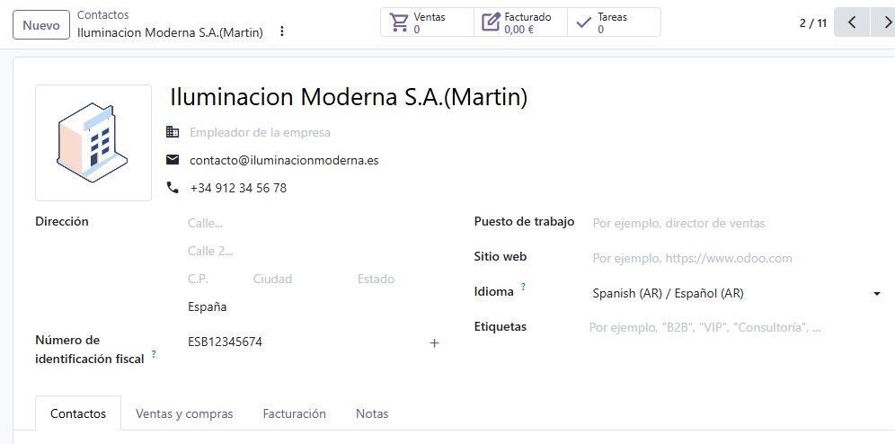
2. Contacto:

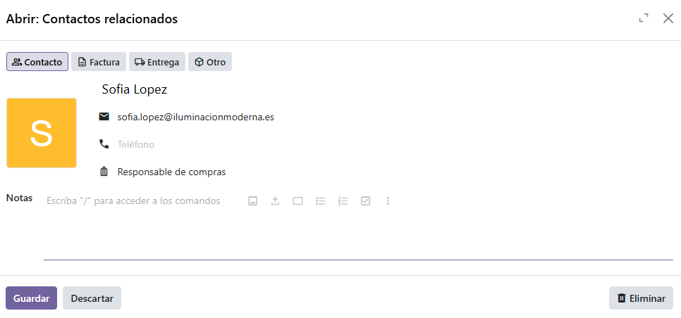
Vinculación con la empresa
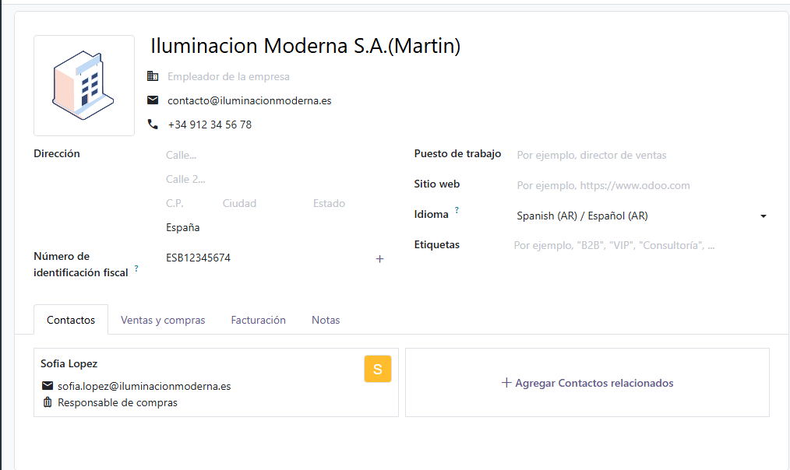

3. Direccion:
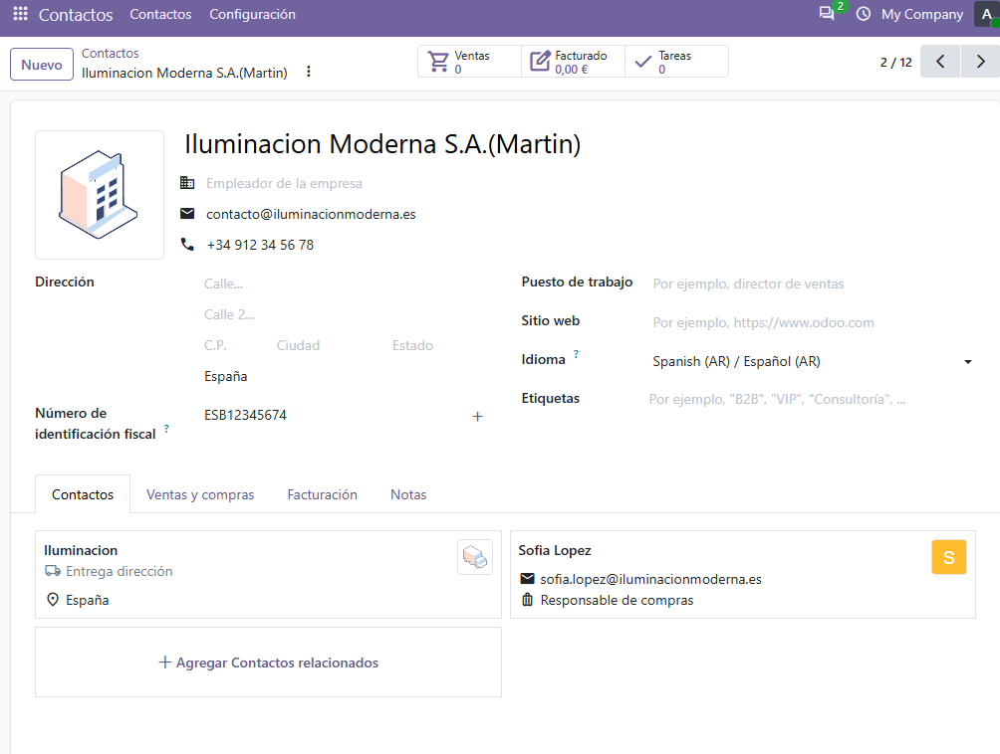
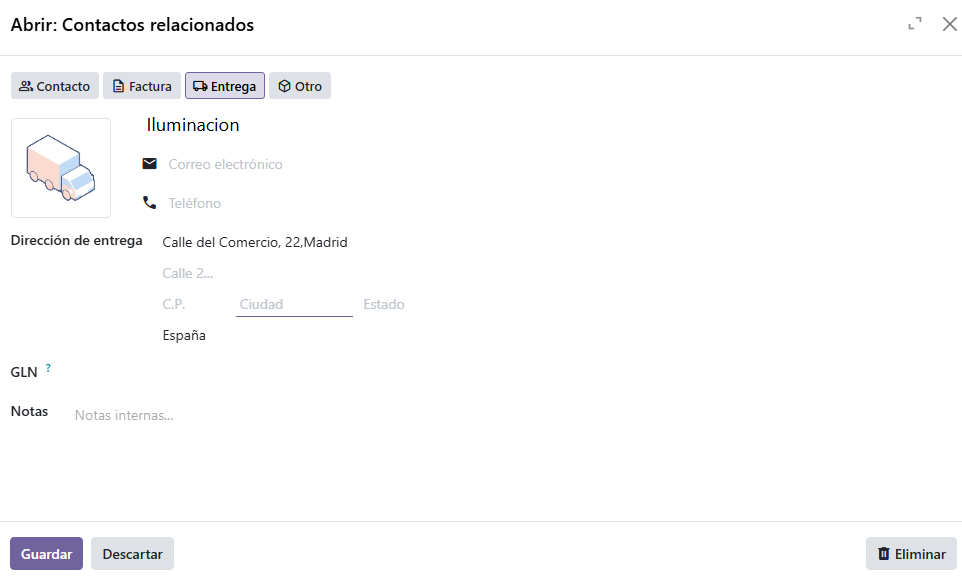

### __Ejercicio 2__

**1. Producto**
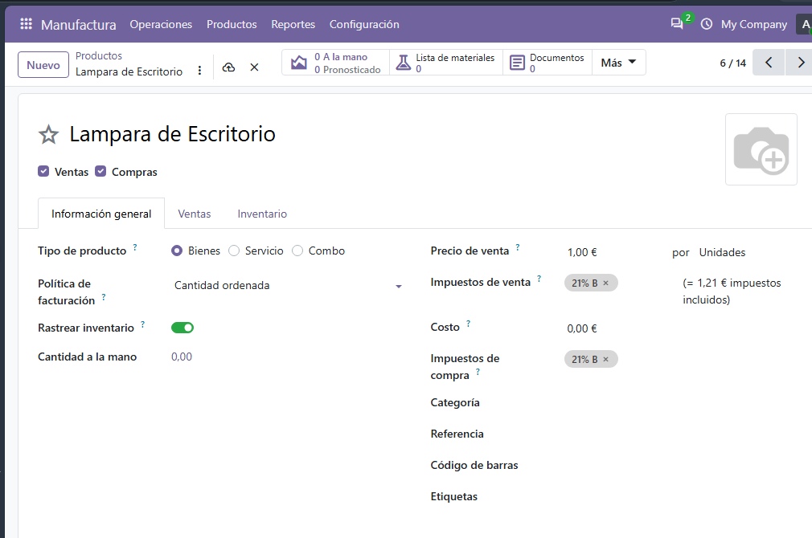
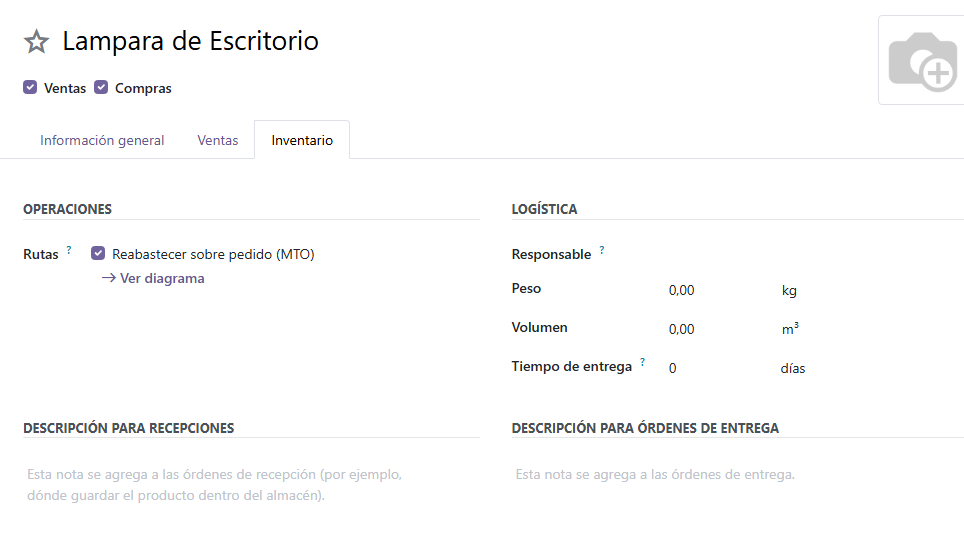

**2. Componentes**
Componentes creados
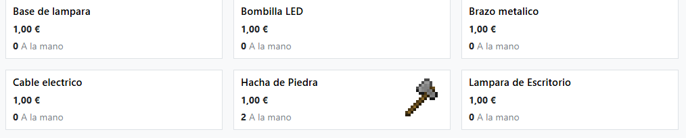
Reabastecimiento
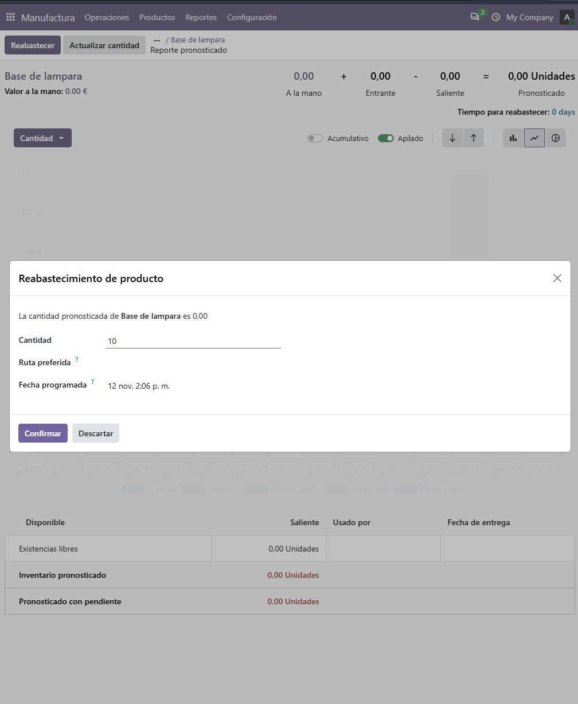
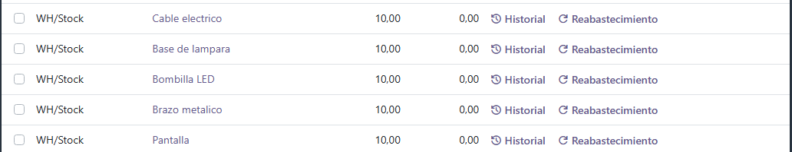
Productos reabastecidos
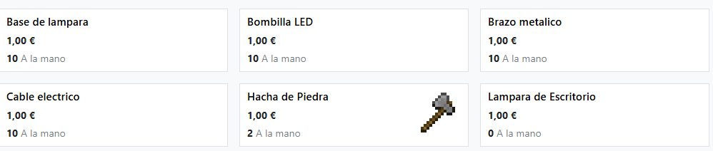

**3. Lista de Materiales**
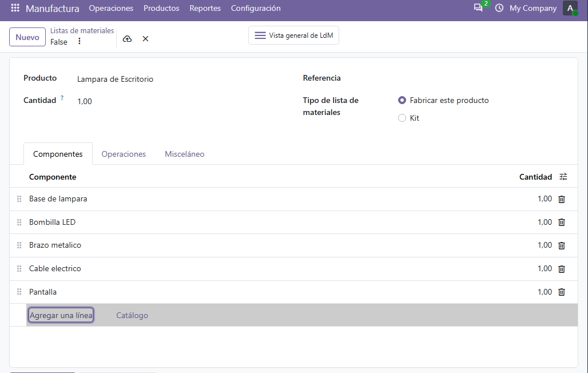

**4. Orden de Fabricacion y Finalización de fabricación**
Captura con la visualización de stock disponible
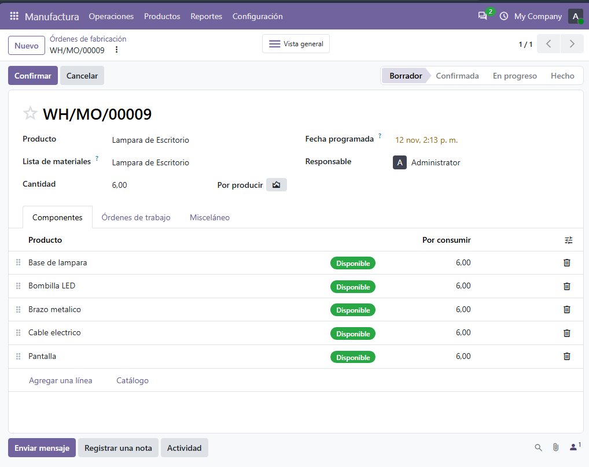
Producto fabricado
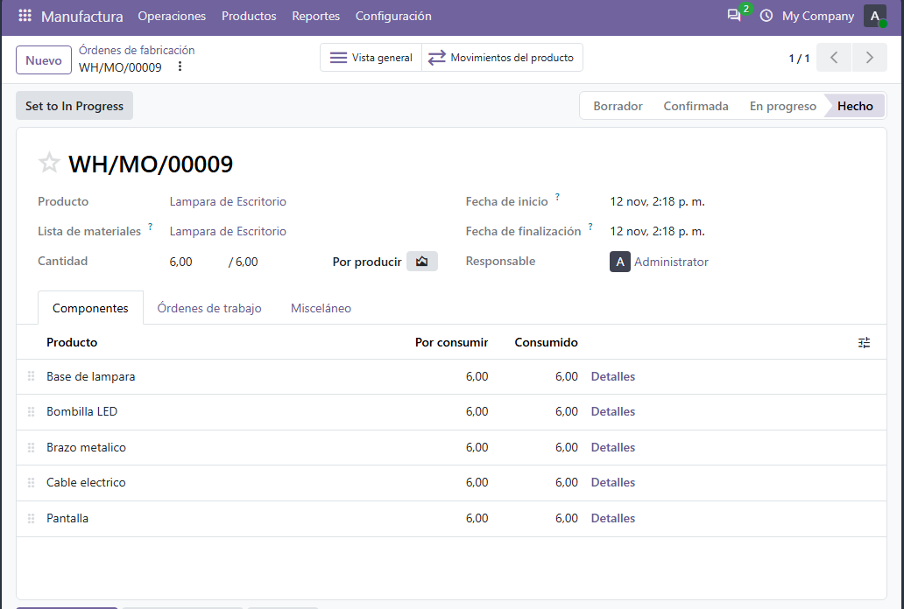
Cantidad de productos
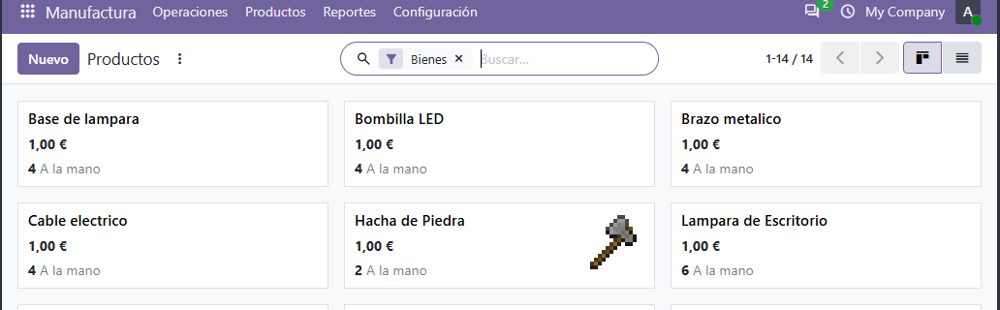

