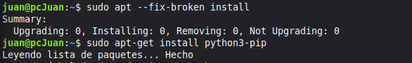
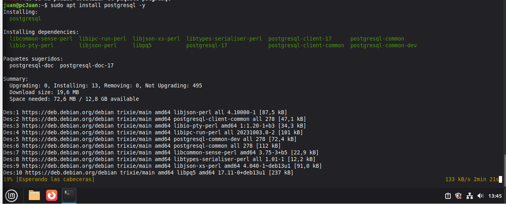
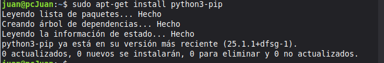
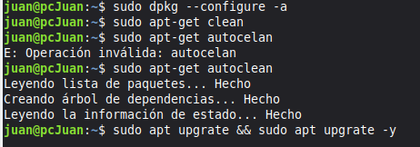
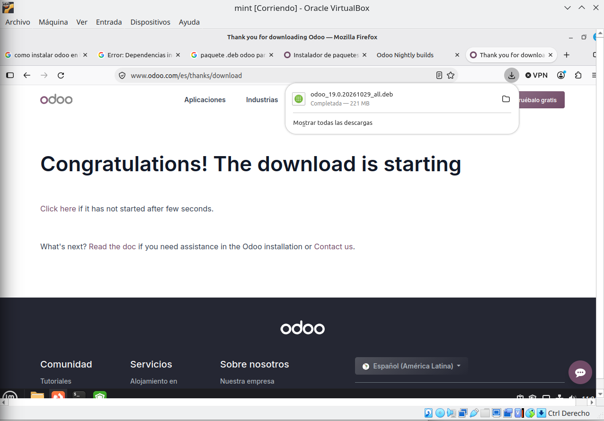
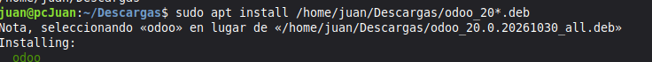
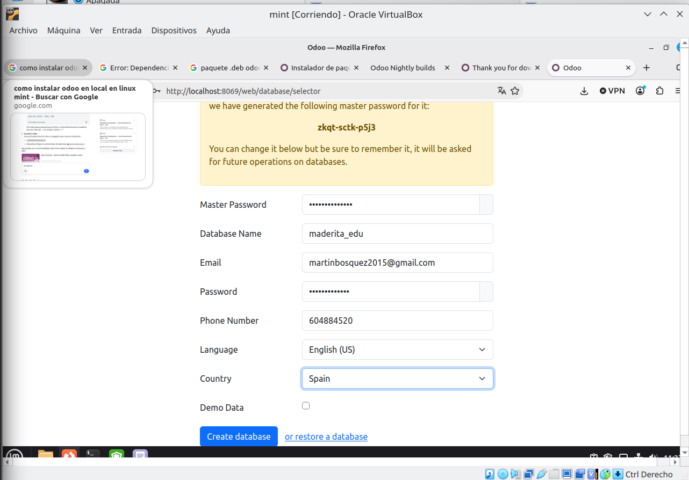
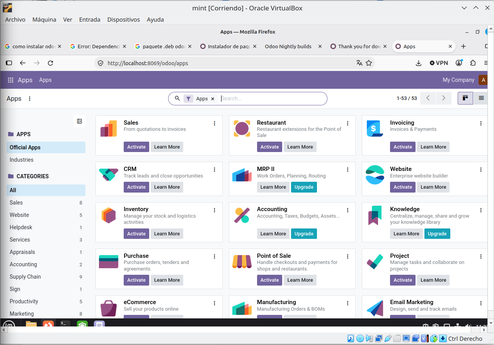

# <center>IES FRANCISCO DE GOYA</center>
__NOMBRE:__ Martin Taboada  
__CURSO:__ DAM 2
## <center> __Sistemas de Gestión empresarial:__</center>   <center> __Instalación de odoo en local en Ubuntu__</center>
A continuación se presentarán evidencias sobre la instalacion en el aula virtual, se presentarán imagenes del paso a paso realizado: 
 ### __Instalaciónes necesarias previas a Odoo__
 la instalación de Python3 y postgresql será imprescindible para poceder con la instalción y el correcto funcionamiento de ubunto. Sin embargo, realizar esta instalación puede llegar a generar problemas inicialmente, por lo que se ejecutarán ciertos codigos en la terminal:


 
 
 

 

  ### __Instalación de Odoo__

  Primero se procederá a descargar el paquete ```.deb``` en la página oficial y se procederá con la instalación mediante terminal:


 

 

 ### __Apertura en local__

 
 