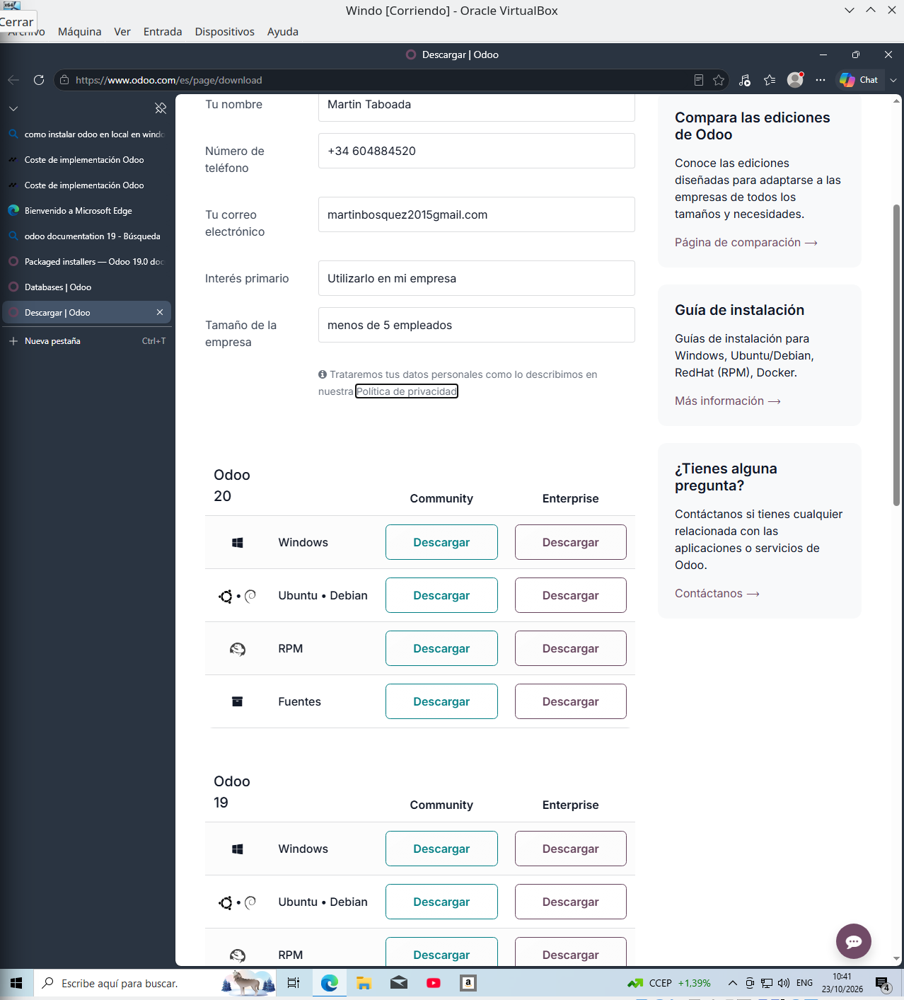
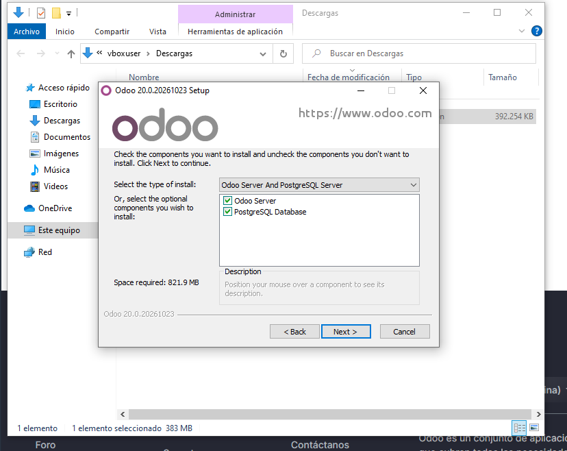
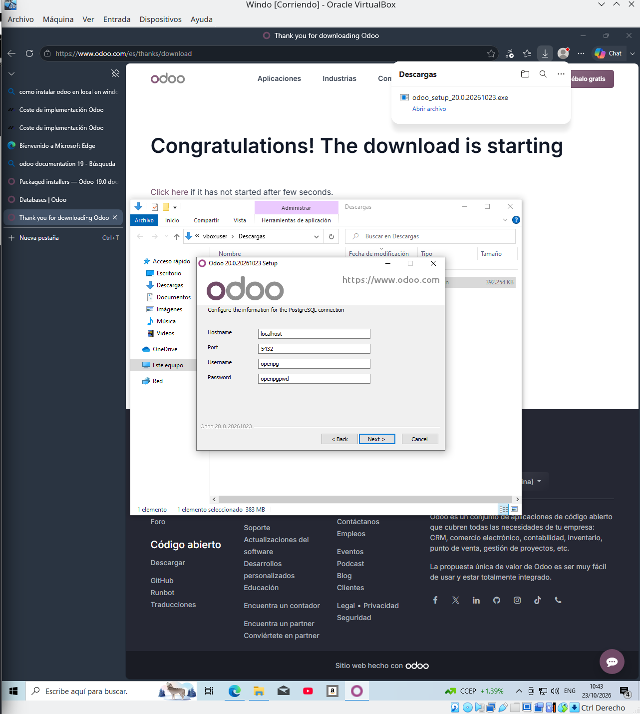
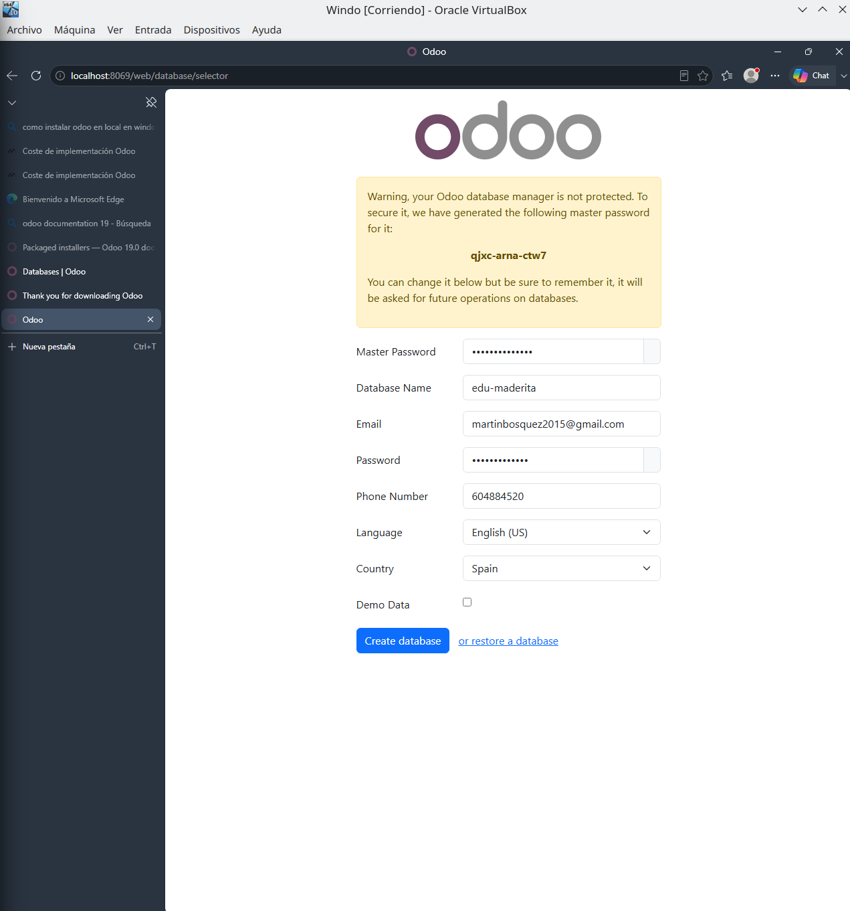
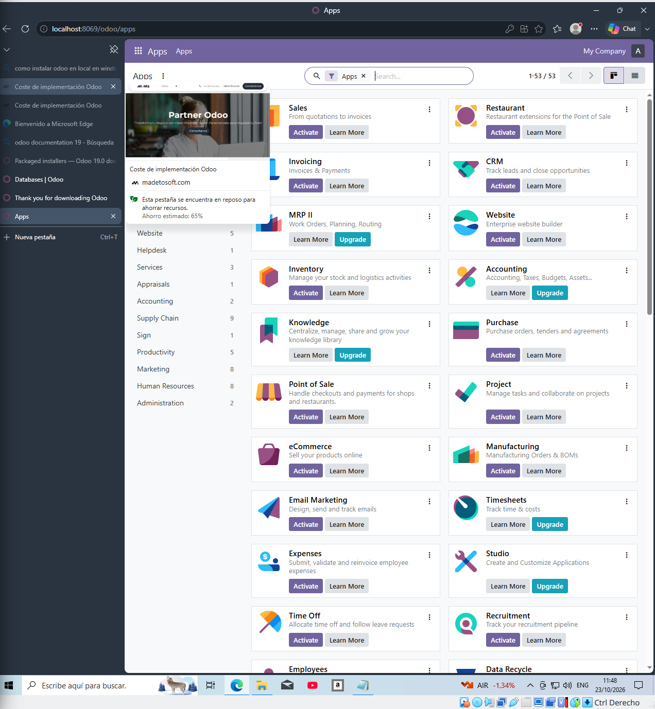

# 
IES FRANCISCO DE GOYA

__NOMBRE:__ Martin Taboada  
__CURSO:__ DAM 2
## 
 __Sistemas de Gestión empresarial:__
   
 __Instalación de odoo en local en windows__

A continuación se presentarán evidencias sobre la instalacion en el aula virtual, se presentarán imagenes del paso a paso realizado: 

