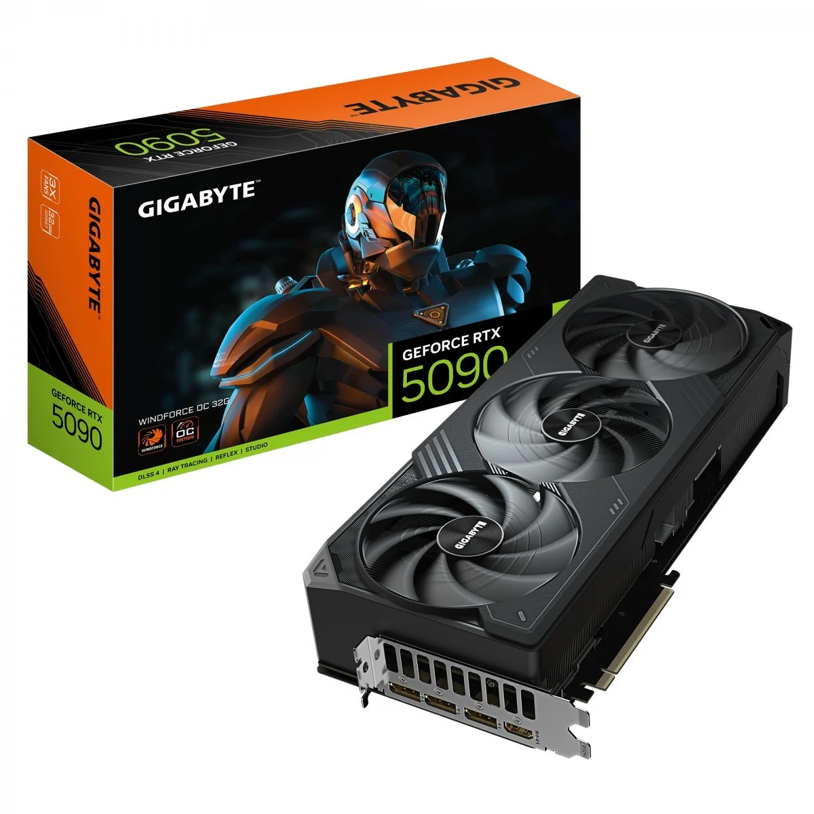
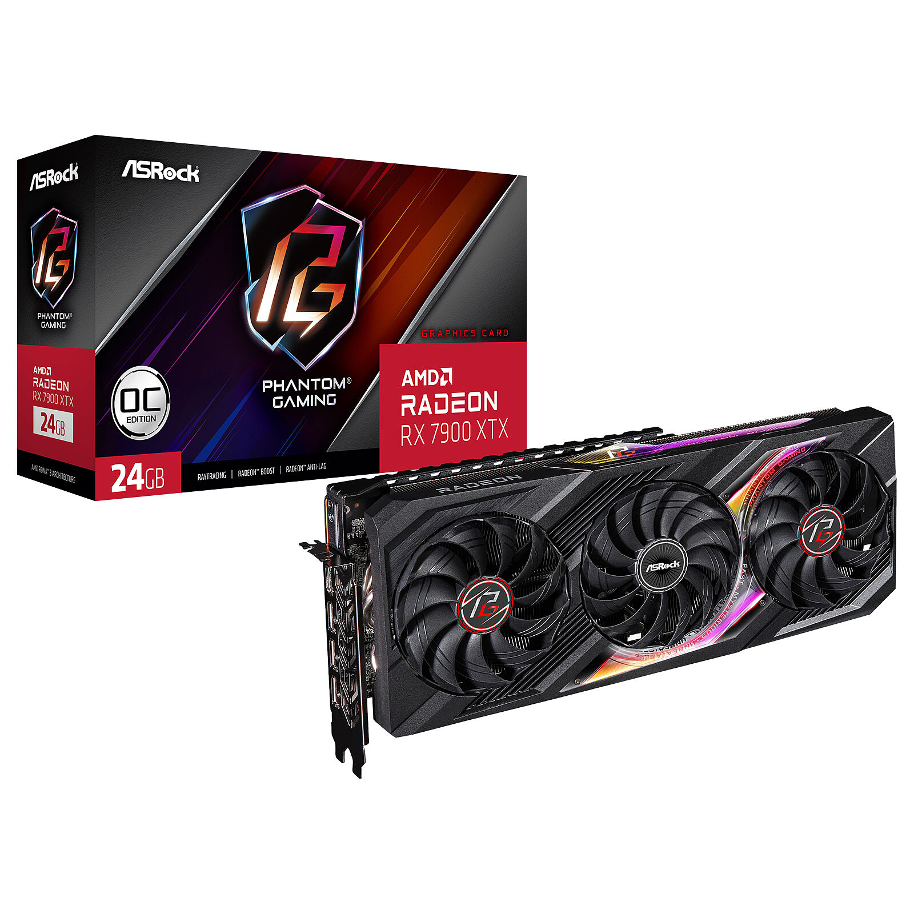

# 
IES FRANCISCO DE GOYA

__NOMBRE:__ Martin Taboada  
__CURSO:__ DAM 2  
## 
 __Inglés Técnico:__
   
 __GPU Comparison: NVIDIA GeForce RTX 5090 vs AMD Radeon RX 9900 XTX__

<!-- INSERTA AQUÍ LAS CAPTURAS DE PANTALLA DE LAS DOS GRÁFICAS / INSERT SCREENSHOTS HERE -->

### __1. Overview and Technical Specifications__

| Feature | NVIDIA GeForce RTX 5090 | AMD Radeon RX 9900 XTX |
|---|---|---|
| **VRAM Memory** | 32 GB GDDR7 | 24 GB GDDR6X |
| **Power Consumption** | 600 W | 450 W |
| **Target Resolution** | 4K / 8K Gaming | 4K Gaming |
| **Ray Tracing Performance** | Extremely High | High |
| **Price (MSRP)** | $1,999 | $1,199 |

&emsp;Choosing a high-end graphics card is always a difficult choice because both brands offer strong hardware. In this comparison, we will analyze five key features: design, technical specifications, performance, power consumption/durability, and price to see which card is the best option for users today.

### __2. Feature Comparison__

**1. Design and Size**

&emsp;The RTX 5090 is noticeably bigger and heavier than the RX 9900 XTX. NVIDIA's card takes up almost four slots in a PC case, so you need a very large tower. On the other hand, AMD’s design is more compact and easier to install in standard computer cases.

 
 

**2. Technical Specifications**

&emsp;When looking at the numbers, NVIDIA offers more VRAM with 32 GB of modern GDDR7 memory, whereas AMD comes with 24 GB of GDDR6X. This means the RTX 5090 has a wider memory bandwidth, making it better prepared for future heavy workloads.

**3. Speed and Performance**

&emsp;In pure power and frame rates, the RTX 5090 is clearly faster than the RX 9900 XTX, especially in ray-tracing technology and AI rendering (DLSS). However, AMD's card is still extremely powerful for traditional 4K gaming and runs fast enough for almost any modern video game.

**4. Power Consumption and Durability**

&emsp;The RX 9900 XTX is much more efficient than its competitor. The RTX 5090 consumes up to 600W and gets very hot, which means you need a stronger power supply and a top-tier cooling system to keep it durable over time. The AMD model is less demanding and easier to keep cool.

**5. Price**

&emsp;Price is the biggest difference here. The RTX 5090 costs around $1,999, making it much more expensive than the RX 9900 XTX, which costs around $1,199. NVIDIA delivers better performance, but AMD offers a far better balance between price and quality.

### __3. Final Choice and Justification__

&emsp;After comparing both graphics cards, I would choose the **AMD Radeon RX 9900 XTX**. Although NVIDIA's RTX 5090 is undeniably the most powerful card on the market, it is far too expensive for most users and consumes a huge amount of electricity. The RX 9900 XTX offers fantastic 4K gaming performance, uses less power, and costs almost $800 less, making it a much smarter investment overall.

---

### __References__
* TechPowerUp GPU Database: https://www.techpowerup.com
* Tom's Hardware GPU Benchmarks & Hierarchy: https://www.tomshardware.com